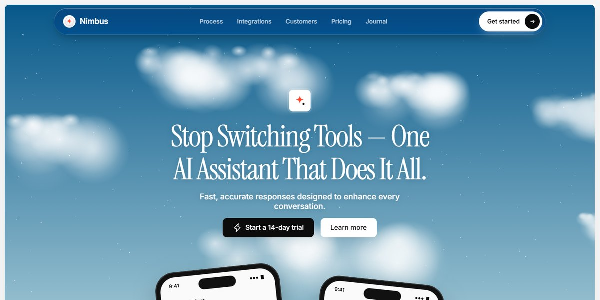

# Nimbus AI Assistant Page

A light, coral-accented page for an all-in-one AI assistant: a hero under a parallax sky of canvas-drawn clouds with two tilted CSS phones, a glass-pill nav that shrinks on scroll, a three-slide product carousel, a logo ticker, a dark integrations panel with tool tiles orbiting the logo on three rings, masonry testimonials, pricing with a shared annual switch, journal cards with SVG art, an FAQ accordion and a sky CTA that overlaps the footer.

**Open it:** [`index.html`](index.html) runs straight from disk — one file, every asset inlined, no build step. [Live demo](https://instalanding.ai/demos/nimbus-ai-assistant.html) · [Page on InstaLanding](https://instalanding.ai/prompt/nimbus-ai-assistant-page)

**The prompt:** [`PROMPT.md`](PROMPT.md) is this same file with a short instruction on top: keep the design, replace the brand and copy, convert to your stack. Paste it into Claude Code, Cursor, ChatGPT or any builder and it builds this page.

| | |
| --- | --- |
| Best for | AI assistants and copilots, productivity SaaS, mobile-first AI apps, integration-heavy platforms |
| Style | light, serif-display, sky, glassmorphism, phone-mockups |
| Sections | nav → hero → process → integrations → testimonials → pricing → blog → faq → cta → footer |
| Libraries | none — plain HTML, CSS and JS |
| Fonts | Instrument Serif, Inter |
| Uses | canvas-2d, inline-svg, reduced-motion |
| Size | 87 KB · prompt ~22,327 tokens |

Every region is tagged `data-section`, and the file opens with a header comment that maps its design tokens, sections and scripts, and lists what breaks when you edit it. Read that first.

The layout follows a design credited in the page's footer ("Design by Amar KZR"); keep that credit if you ship it.

The brand, copy, numbers and testimonials on this page are fictional. Replace them before you ship.
