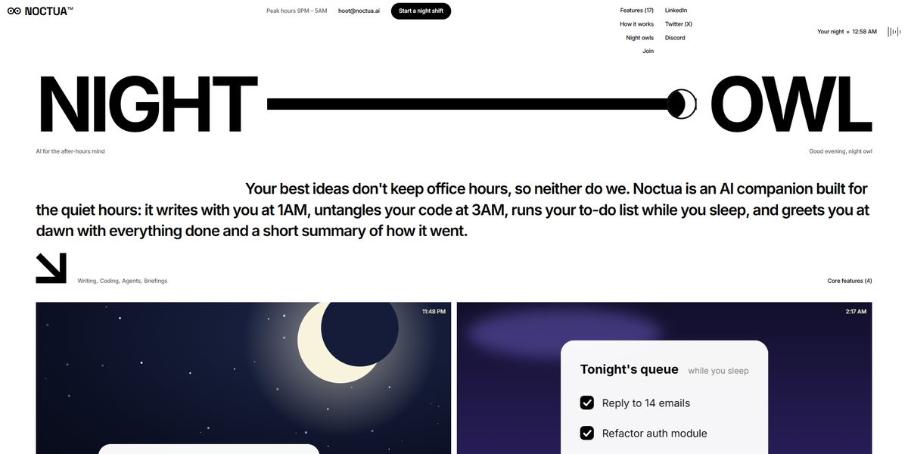

# Noctua AI Night Owl Page

A stark black-on-white page for an AI that works the night shift: a quartered loader with blinking owl eyes and a counter, a giant NIGHT ——◐ OWL headline whose moon slides through its phases, the viewer's own clock and a greeting for their hour, and four illustrated feature cards (a starlit draft, an overnight task queue, glowing owl eyes, a sunrise digest) drawn in SVG.

**Open it:** [`index.html`](index.html) runs straight from disk — one file, every asset inlined, no build step. [Live demo](https://instalanding.ai/demos/noctua-night-owl.html) · [Page on InstaLanding](https://instalanding.ai/prompt/noctua-ai-night-owl-page)

**The prompt:** [`PROMPT.md`](PROMPT.md) is this same file with a short instruction on top: keep the design, replace the brand and copy, convert to your stack. Paste it into Claude Code, Cursor, ChatGPT or any builder and it builds this page.

| | |
| --- | --- |
| Best for | AI assistants and agents, productivity tools, consumer AI launches, brands with a playful, editorial voice |
| Style | light, minimal, brutalist, editorial, svg-illustration |
| Sections | loader → nav → hero → features → how-it-works → arrows → night-owls → footer |
| Libraries | none — plain HTML, CSS and JS |
| Fonts | Inter, Space Grotesk (Google Fonts) |
| Uses | inline-svg, reduced-motion |
| Size | 44 KB · prompt ~11,489 tokens |

Every region is tagged `data-section`, and the file opens with a header comment that maps its design tokens, sections and scripts, and lists what breaks when you edit it. Read that first.

The brand, copy, numbers and testimonials on this page are fictional. Replace them before you ship.
