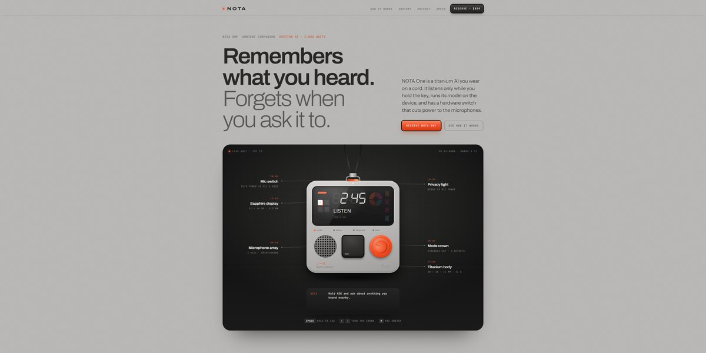

# NOTA Wearable AI Page

A quiet-luxury catalogue for a titanium AI wearable: a live device you can use in the hero (hold to ask, turn the crown, flip the mic switch), close-ups that are clones of it, a seven-segment privacy ledger and a technical drawing.

**Open it:** [`index.html`](index.html) runs straight from disk — one file, every asset inlined, no build step. [Live demo](https://instalanding.ai/demos/nota-wearable.html) · [Page on InstaLanding](https://instalanding.ai/prompt/nota-wearable-ai-page)

**Build it yourself:** [`PROMPT.md`](PROMPT.md) is the one-shot brief this file was built from. Paste it into any AI builder or coding agent.

| | |
| --- | --- |
| Best for | hardware and wearable launches, AI devices and gadgets, premium product catalogues, privacy-first products |
| Style | light, skeuomorphic, interactive, hardware, editorial, svg |
| Sections | nav → hero → stats → how-it-works → anatomy → privacy → modes → build → specs → order → footer |
| Libraries | none — plain HTML, CSS and JS |
| Fonts | Archivo, Instrument Sans, JetBrains Mono, Noto Sans JP (Google Fonts) |
| Uses | canvas-2d, inline-svg, inlined-images, reduced-motion |
| Size | 78 KB · brief ~1,364 tokens |

Every region is tagged `data-section`, and the file opens with a header comment that maps its design tokens, sections and scripts, and lists what breaks when you edit it. Read that first.

The brand, copy, numbers and testimonials on this page are fictional. Replace them before you ship.
