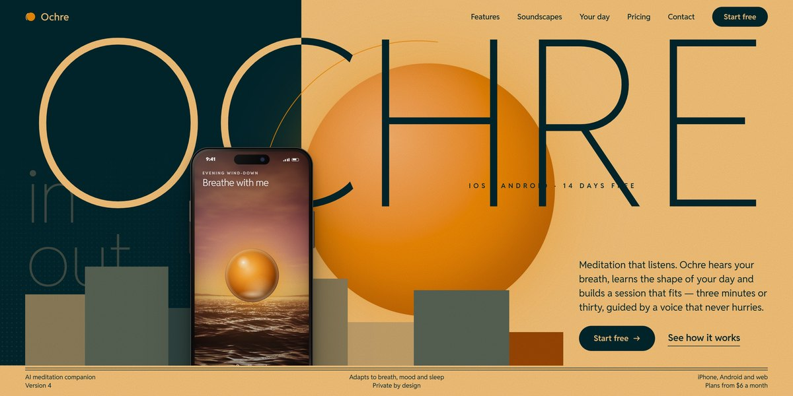

# Ochre AI Meditation App Page

A sunset-poster page for an AI meditation app: a thin "OCHRE" is split ink-on-paper by a dark field that sweeps across as the sun sets, the hero phone breathes over a live WebGL ocean, a moon window opens into the night, and every landscape is painted on canvas.

**Open it:** [`index.html`](index.html) runs straight from disk — one file, every asset inlined, no build step. [Live demo](https://instalanding.ai/demos/ochre-meditation.html) · [Page on InstaLanding](https://instalanding.ai/prompt/ochre-ai-meditation-app-page)

**The prompt:** [`PROMPT.md`](PROMPT.md) is this same file with a short instruction on top: keep the design, replace the brand and copy, convert to your stack. Paste it into Claude Code, Cursor, ChatGPT or any builder and it builds this page.

| | |
| --- | --- |
| Best for | wellness and meditation apps, consumer AI apps, health and sleep products, mobile app launches |
| Style | sunset-poster, minimal-type, canvas-art, webgl, scroll-driven |
| Sections | nav → hero → ticker → manifesto → features → soundscapes → privacy → day → pricing → gallery → reviews → trial → faq → contact → footer |
| Libraries | gsap 3.13.0, lenis 1.3.4 |
| Fonts | Reddit Sans (Google Fonts) |
| Uses | webgl, canvas-2d, inline-svg, inlined-images, reduced-motion |
| Size | 115 KB · prompt ~29,734 tokens |

Every region is tagged `data-section`, and the file opens with a header comment that maps its design tokens, sections and scripts, and lists what breaks when you edit it. Read that first.

The brand, copy, numbers and testimonials on this page are fictional. Replace them before you ship.
