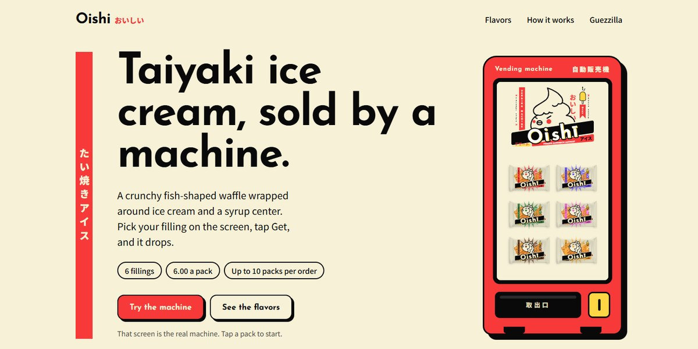

# Oishi Taiyaki Ice Cream Page

A cream-and-red page for taiyaki ice cream sold from a vending machine, with the machine's real touchscreen playable in the hero, a six-flavor picker whose art and accent recolor live, and a guess-the-flavor mini game.

**Open it:** [`index.html`](index.html) runs straight from disk — one file, every asset inlined, no build step. [Live demo](https://instalanding.ai/demos/oishi-taiyaki-ice-cream.html) · [Page on InstaLanding](https://instalanding.ai/prompt/oishi-taiyaki-ice-cream-page)

**The prompt:** [`PROMPT.md`](PROMPT.md) is this same file with a short instruction on top: keep the design, replace the brand and copy, convert to your stack. Paste it into Claude Code, Cursor, ChatGPT or any builder and it builds this page.

| | |
| --- | --- |
| Best for | food and dessert brands, vending and kiosk products, Japanese and Asian food concepts, playful consumer launches |
| Style | light, retro, hard-shadows, japanese-type, rive, interactive |
| Sections | nav → hero → flavors → how-it-works → game → footer |
| Libraries | none — plain HTML, CSS and JS |
| Fonts | Josefin Sans and Noto Sans JP, inlined as woff2 |
| Uses | canvas-2d, inlined-fonts, inlined-images, reduced-motion |
| Size | 1623 KB · prompt ~415,785 tokens |

Every region is tagged `data-section`, and the file opens with a header comment that maps its design tokens, sections and scripts, and lists what breaks when you edit it. Read that first.

The brand, copy, numbers and testimonials on this page are fictional. Replace them before you ship.
