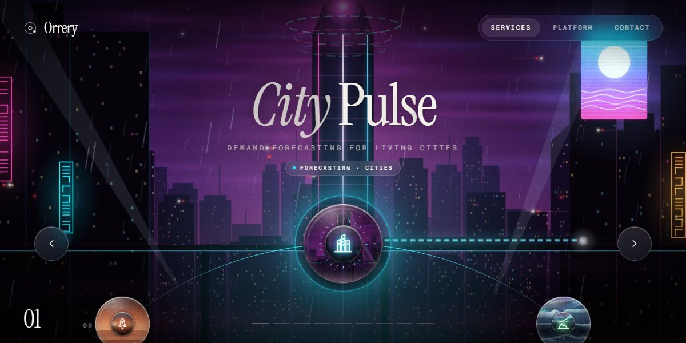

# Orrery AI Services Ring Page

A single-screen carousel for an AI platform of nine services: nine glass lenses with refracting edges turn on a ticked ring, each opening a full-screen world painted live in canvas (a neon city in rain, an aurora over a frozen lake, a synthwave horizon, a reef, Earth from orbit, cherry blossom, a circuit canyon, a crystal cave, a Mars base) as the accent colour drifts to match.

**Open it:** [`index.html`](index.html) runs straight from disk — one file, every asset inlined, no build step. [Live demo](https://instalanding.ai/demos/orrery-services-ring.html) · [Page on InstaLanding](https://instalanding.ai/prompt/orrery-ai-services-ring-page)

**The prompt:** [`PROMPT.md`](PROMPT.md) is this same file with a short instruction on top: keep the design, replace the brand and copy, convert to your stack. Paste it into Claude Code, Cursor, ChatGPT or any builder and it builds this page.

| | |
| --- | --- |
| Best for | AI platforms with many products, multi-product SaaS, AI agencies and studios, immersive brand launches |
| Style | dark, canvas-art, glassmorphism, carousel, immersive |
| Sections | nav → ring → hud → about → contact |
| Libraries | none — plain HTML, CSS and JS |
| Fonts | Instrument Serif, Geist, Geist Mono (Google Fonts) |
| Uses | canvas-2d, inline-svg, inlined-images, reduced-motion |
| Size | 115 KB · prompt ~29,103 tokens |

Every region is tagged `data-section`, and the file opens with a header comment that maps its design tokens, sections and scripts, and lists what breaks when you edit it. Read that first.

The brand, copy, numbers and testimonials on this page are fictional. Replace them before you ship.
