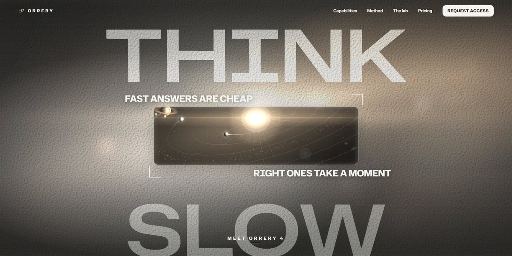

# Orrery Reasoning Engine Page

An AI reasoning engine that shows its work: a hero window opens onto a canvas orrery, and every picture on the page is a live rendering drawn in code.

**Open it:** [`index.html`](index.html) runs straight from disk — one file, every asset inlined, no build step. [Live demo](https://instalanding.ai/demos/orrery-engine.html) · [Page on InstaLanding](https://instalanding.ai/prompt/orrery-reasoning-engine-page)

**Build it yourself:** [`PROMPT.md`](PROMPT.md) is the one-shot brief this file was built from. Paste it into any AI builder or coding agent.

| | |
| --- | --- |
| Best for | AI models and reasoning products, research and analytics tools, enterprise AI platforms, deep-tech launches |
| Style | dark, generative, canvas, gsap, scroll-driven, editorial |
| Sections | nav → hero → brief → capabilities → process → gallery → results → team → reviews → pricing → faq → contact → footer |
| Libraries | gsap 3.13.0, lenis 1.3.4 |
| Fonts | Hubot Sans, Instrument Sans (Google Fonts) |
| Uses | canvas-2d, inline-svg, inlined-images, reduced-motion |
| Size | 121 KB · brief ~1,897 tokens |

Every region is tagged `data-section`, and the file opens with a header comment that maps its design tokens, sections and scripts, and lists what breaks when you edit it. Read that first.

The brand, copy, numbers and testimonials on this page are fictional. Replace them before you ship.
