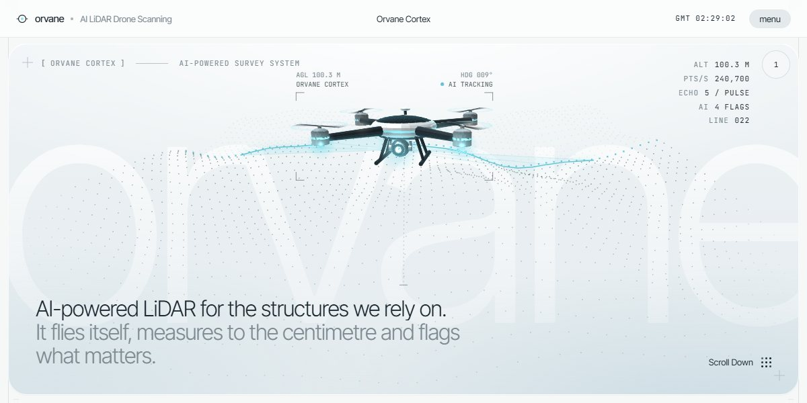

# Orvane AI LiDAR Drone Page

A pale survey-instrument page for an AI LiDAR drone: a point-cloud preloader splits open on a shaded 3D drone sweeping a laser line across scanned terrain, sticky scenes flag a sagging bridge, morph point clouds between industries and draw a mountain range line by line, and a working controller lets you fly the drone.

**Open it:** [`index.html`](index.html) runs straight from disk — one file, every asset inlined, no build step. [Live demo](https://instalanding.ai/demos/orvane-lidar-drone.html) · [Page on InstaLanding](https://instalanding.ai/prompt/orvane-ai-lidar-drone-page)

**The prompt:** [`PROMPT.md`](PROMPT.md) is this same file with a short instruction on top: keep the design, replace the brand and copy, convert to your stack. Paste it into Claude Code, Cursor, ChatGPT or any builder and it builds this page.

| | |
| --- | --- |
| Best for | drones and robotics, industrial inspection and infrastructure AI, geospatial and mapping, hardware product launches |
| Style | light, minimal, canvas-art, 3d-canvas, scroll-driven, interactive |
| Sections | nav → hero → promise → gear → numbers → solutions → capabilities → controller → software → terrain → footer |
| Libraries | none — plain HTML, CSS and JS |
| Fonts | Inter Tight, JetBrains Mono (Google Fonts) |
| Uses | canvas-2d, inline-svg, inlined-images, reduced-motion |
| Size | 129 KB · prompt ~33,122 tokens |

Every region is tagged `data-section`, and the file opens with a header comment that maps its design tokens, sections and scripts, and lists what breaks when you edit it. Read that first.

The brand, copy, numbers and testimonials on this page are fictional. Replace them before you ship.
