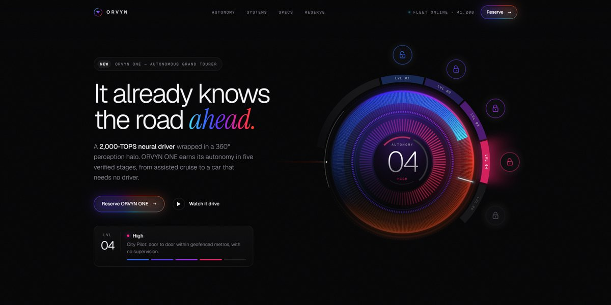

# ORVYN Autonomous Car Page

An AI-native grand tourer on a near-black page: a spectrum autonomy dial steps through five levels, unlocking pods as it goes, over a radar, live telemetry and a horizon of light.

**Open it:** [`index.html`](index.html) runs straight from disk — one file, every asset inlined, no build step. [Live demo](https://instalanding.ai/demos/orvyn-autonomous-gt.html) · [Page on InstaLanding](https://instalanding.ai/prompt/orvyn-autonomous-car-page)

**Build it yourself:** [`PROMPT.md`](PROMPT.md) is the one-shot brief this file was built from. Paste it into any AI builder or coding agent.

| | |
| --- | --- |
| Best for | automotive and mobility launches, autonomy, robotics and hardware AI, deep-tech product reveals, premium pre-order and reservation pages |
| Style | dark, svg, spectrum, dashboard, interactive, editorial |
| Sections | nav → hero → ticker → autonomy → systems → manifesto → specs → reserve → footer |
| Libraries | none — plain HTML, CSS and JS |
| Fonts | Geist, Geist Mono, Instrument Serif (Google Fonts) |
| Uses | inline-svg, inlined-images, reduced-motion |
| Size | 64 KB · brief ~1,346 tokens |

Every region is tagged `data-section`, and the file opens with a header comment that maps its design tokens, sections and scripts, and lists what breaks when you edit it. Read that first.

The brand, copy, numbers and testimonials on this page are fictional. Replace them before you ship.
