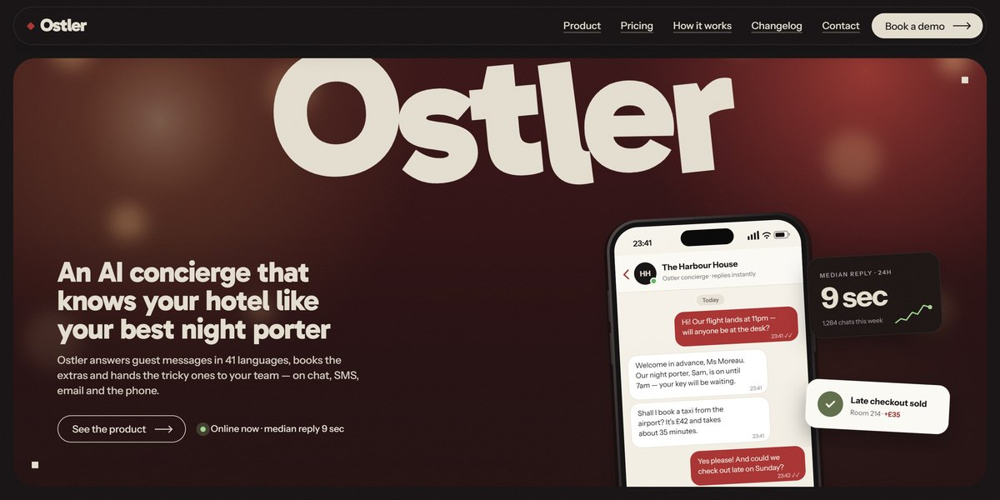

# Ostler AI Hotel Concierge Page

A late-night oxblood page for an AI hotel concierge: a giant "Ostler" springs apart letter by letter over a guest's phone chat, six module covers slide past sideways, "Awake" zooms into a hotel facade at night, and every phone, dashboard and room is drawn in SVG.

**Open it:** [`index.html`](index.html) runs straight from disk — one file, every asset inlined, no build step. [Live demo](https://instalanding.ai/demos/ostler-hotel-concierge.html) · [Page on InstaLanding](https://instalanding.ai/prompt/ostler-ai-hotel-concierge-page)

**Build it yourself:** [`PROMPT.md`](PROMPT.md) is the one-shot brief this file was built from. Paste it into any AI builder or coding agent.

| | |
| --- | --- |
| Best for | hospitality software, AI agents and assistants, customer support automation, vertical B2B SaaS |
| Style | editorial, card-stack, fill-type, svg-illustration, scroll-driven |
| Sections | nav → hero → ticker → logos → story → modules → pricing → statement → process → changelog → voices → gallery → faq → contact → footer |
| Libraries | gsap 3.13.0, lenis 1.3.4 |
| Fonts | Gabarito, Instrument Sans (Google Fonts) |
| Uses | inline-svg, inlined-images, reduced-motion |
| Size | 138 KB · brief ~1,463 tokens |

Every region is tagged `data-section`, and the file opens with a header comment that maps its design tokens, sections and scripts, and lists what breaks when you edit it. Read that first.

The brand, copy, numbers and testimonials on this page are fictional. Replace them before you ship.
