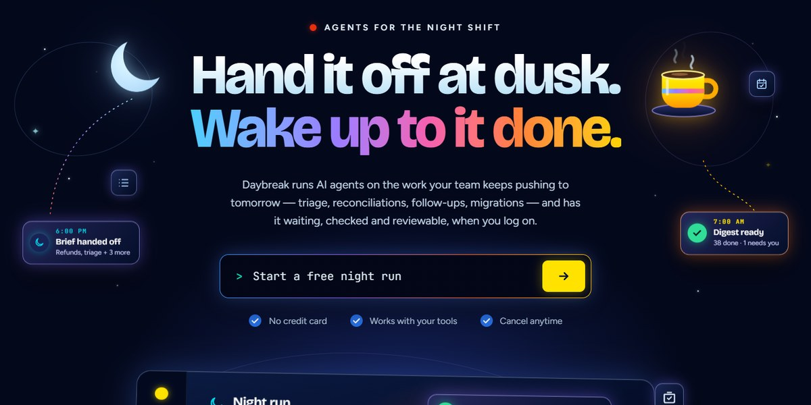

# Paper Sun Agent Page

AI agents for the night shift: a paper-cut sunset panel you can slap stickers on, a dusk-to-daybreak arc, and a run log that stops to ask.

**Open it:** [`index.html`](index.html) runs straight from disk — one file, every asset inlined, no build step. [Live demo](https://instalanding.ai/demos/daybreak-night-shift.html) · [Page on InstaLanding](https://instalanding.ai/prompt/paper-sun-agent-page)

**Build it yourself:** [`PROMPT.md`](PROMPT.md) is the one-shot brief this file was built from. Paste it into any AI builder or coding agent.

| | |
| --- | --- |
| Best for | AI agent products, automation and back-office tools, async and overnight workflows, B2B SaaS with personality |
| Style | dark, night, sunset-gradient, paper-cut, 3d-panel, playful, spectrum-type |
| Sections | nav → hero → how-it-works → features → run-log → pricing → faq → cta → footer |
| Libraries | none — plain HTML, CSS and JS |
| Fonts | Bricolage Grotesque, Figtree, JetBrains Mono (Google Fonts) |
| Uses | inline-svg, reduced-motion |
| Size | 127 KB · brief ~1,424 tokens |

Every region is tagged `data-section`, and the file opens with a header comment that maps its design tokens, sections and scripts, and lists what breaks when you edit it. Read that first.

The brand, copy, numbers and testimonials on this page are fictional. Replace them before you ship.
