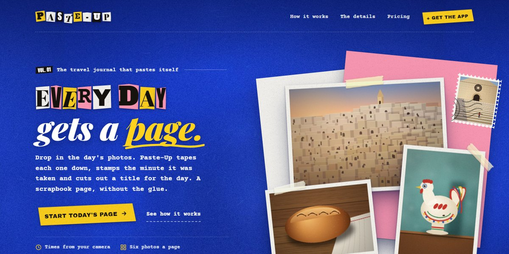

# Paste-Up Travel Journal Page

A cobalt scrapbook page for a travel journal app that pastes itself: three taped photo prints and a postage stamp that fly onto loose paper sheets and drift with the pointer, ransom-note titles cut letter by letter from six typefaces, and a tilted tape marquee.

**Open it:** [`index.html`](index.html) runs straight from disk — one file, every asset inlined, no build step. [Live demo](https://instalanding.ai/demos/paste-up-travel-journal.html) · [Page on InstaLanding](https://instalanding.ai/prompt/paste-up-travel-journal-page)

**The prompt:** [`PROMPT.md`](PROMPT.md) is this same file with a short instruction on top: keep the design, replace the brand and copy, convert to your stack. Paste it into Claude Code, Cursor, ChatGPT or any builder and it builds this page.

| | |
| --- | --- |
| Best for | travel and photo apps, journaling and memory-keeping products, consumer mobile app launches, playful creative tools |
| Style | scrapbook, collage, ransom-note-type, cobalt, editorial, css-only-motion |
| Sections | hero → nav → how → details → trip → pricing → cta → footer |
| Libraries | none — plain HTML, CSS and JS |
| Fonts | Abril Fatface, Alfa Slab One, Anton, Archivo Black, Courier Prime, Playfair Display |
| Uses | inline-svg, inlined-images, reduced-motion |
| Size | 773 KB · prompt ~198,196 tokens |

Every region is tagged `data-section`, and the file opens with a header comment that maps its design tokens, sections and scripts, and lists what breaks when you edit it. Read that first.

The brand, copy, numbers and testimonials on this page are fictional. Replace them before you ship.
