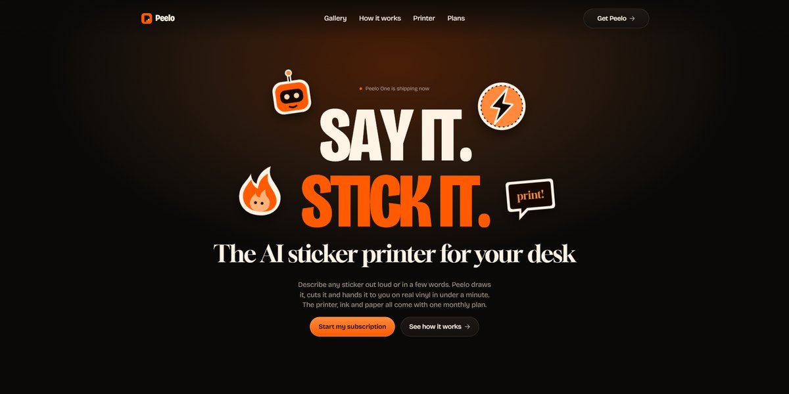

# Peelo AI Sticker Printer Page

A warm-black subscription page for an AI sticker printer: a condensed SAY IT. STICK IT. headline that blurs in letter by letter under an orange glow with four die-cut stickers popping around it, a gallery of sticker sheets with their prompts on hover, five how-it-works rows that stack as you scroll, the printer and its refills on tilted cards, three plans and a drag-to-scroll review slider, every picture drawn in SVG.

**Open it:** [`index.html`](index.html) runs straight from disk — one file, every asset inlined, no build step. [Live demo](https://instalanding.ai/demos/peelo-sticker-printer.html) · [Page on InstaLanding](https://instalanding.ai/prompt/peelo-ai-sticker-printer-page)

**The prompt:** [`PROMPT.md`](PROMPT.md) is this same file with a short instruction on top: keep the design, replace the brand and copy, convert to your stack. Paste it into Claude Code, Cursor, ChatGPT or any builder and it builds this page.

| | |
| --- | --- |
| Best for | consumer hardware and gadgets, subscription products, AI creative tools, playful D2C launches |
| Style | dark, bold-type, stickers, svg-illustration, scroll-driven |
| Sections | nav → hero → press → gallery → how-it-works → printer → plans → reviews → footer |
| Libraries | none — plain HTML, CSS and JS |
| Fonts | Bricolage Grotesque, Gloock (Google Fonts) |
| Uses | inline-svg, inlined-images, reduced-motion |
| Size | 65 KB · prompt ~16,796 tokens |

Every region is tagged `data-section`, and the file opens with a header comment that maps its design tokens, sections and scripts, and lists what breaks when you edit it. Read that first.

The brand, copy, numbers and testimonials on this page are fictional. Replace them before you ship.
