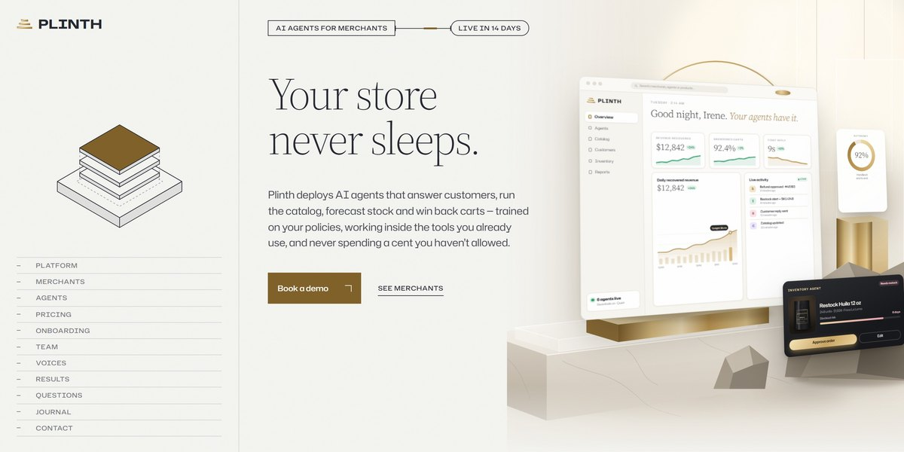

# Plinth AI Merchant Agents Page

A gallery-quiet page for AI agents that run online stores: the store console stands on a marble and brass plinth in 3D, a pinned stack separates into the three layers every agent stands on, blueprint frames draw round each agent at work, and onboarding runs sideways along a lit wire.

**Open it:** [`index.html`](index.html) runs straight from disk — one file, every asset inlined, no build step. [Live demo](https://instalanding.ai/demos/plinth-merchant-agents.html) · [Page on InstaLanding](https://instalanding.ai/prompt/plinth-ai-merchant-agents-page)

**The prompt:** [`PROMPT.md`](PROMPT.md) is this same file with a short instruction on top: keep the design, replace the brand and copy, convert to your stack. Paste it into Claude Code, Cursor, ChatGPT or any builder and it builds this page.

| | |
| --- | --- |
| Best for | e-commerce and retail AI, B2B SaaS for merchants, AI agent platforms, premium product launches |
| Style | editorial, luxury, 3d-css, svg-illustration, scroll-driven |
| Sections | nav → hero → platform → merchants → agents → pricing → onboarding → team → voices → results → faq → journal → contact → footer |
| Libraries | gsap 3.13.0, lenis 1.3.4 |
| Fonts | Hubot Sans, Source Serif 4 (Google Fonts) |
| Uses | inline-svg, inlined-images, reduced-motion |
| Size | 191 KB · prompt ~48,984 tokens |

Every region is tagged `data-section`, and the file opens with a header comment that maps its design tokens, sections and scripts, and lists what breaks when you edit it. Read that first.

The brand, copy, numbers and testimonials on this page are fictional. Replace them before you ship.
