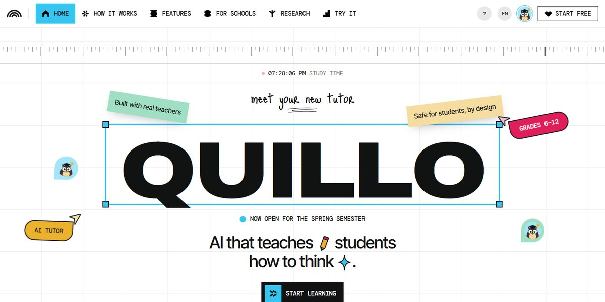

# Quillo AI Tutor Page

A bright, hand-made page for an AI tutor on a graph-paper grid: a giant QUILLO in a selection box with handles, sticky notes, cursor tags and owl avatars, a statement that lights word by word, draggable polaroids, four feature cards with folder tabs that stack as you scroll, and a googly-eyed blob that follows your cursor.

**Open it:** [`index.html`](index.html) runs straight from disk — one file, every asset inlined, no build step. [Live demo](https://instalanding.ai/demos/quillo-ai-tutor.html) · [Page on InstaLanding](https://instalanding.ai/prompt/quillo-ai-tutor-page)

**The prompt:** [`PROMPT.md`](PROMPT.md) is this same file with a short instruction on top: keep the design, replace the brand and copy, convert to your stack. Paste it into Claude Code, Cursor, ChatGPT or any builder and it builds this page.

| | |
| --- | --- |
| Best for | edtech and AI tutoring, consumer AI products, school and classroom software, playful startup launches |
| Style | light, playful, brutalist, svg-illustration, scroll-driven |
| Sections | nav → hero → how-it-works → features → footer |
| Libraries | none — plain HTML, CSS and JS |
| Fonts | Archivo, DM Mono, Inter Tight, Just Me Again Down Here (Google Fonts) |
| Uses | inline-svg, reduced-motion |
| Size | 101 KB · prompt ~26,107 tokens |

Every region is tagged `data-section`, and the file opens with a header comment that maps its design tokens, sections and scripts, and lists what breaks when you edit it. Read that first.

The brand, copy, numbers and testimonials on this page are fictional. Replace them before you ship.
