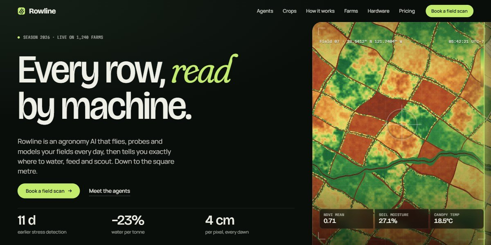

# Rowline Agronomy AI Page

A dark-green landing page for a farm AI: a live NDVI scan wipes across a field rendered pixel by pixel, the scanner's lens opens into a dawn landscape with a drone flying in, five agents slide past sideways, and every field, crop map and device is drawn in code.

**Open it:** [`index.html`](index.html) runs straight from disk — one file, every asset inlined, no build step. [Live demo](https://instalanding.ai/demos/rowline-agronomy-ai.html) · [Page on InstaLanding](https://instalanding.ai/prompt/rowline-agronomy-ai-page)

**Build it yourself:** [`PROMPT.md`](PROMPT.md) is the one-shot brief this file was built from. Paste it into any AI builder or coding agent.

| | |
| --- | --- |
| Best for | agtech and climate-tech startups, AI products with sensors or hardware, drone, mapping and geospatial companies, B2B tools sold to operators in the field |
| Style | dark, procedural-art, canvas, scroll-driven, horizontal-scroll, green |
| Sections | top → about → agents → crops → process → farms → impact → kit → reviews → pricing → pilot → faq → contact |
| Libraries | gsap 3.13.0, lenis 1.3.4 |
| Fonts | Bricolage Grotesque, Manrope, Martian Mono, Fraunces (Google Fonts) |
| Uses | canvas-2d, inline-svg, reduced-motion |
| Size | 109 KB · brief ~1,761 tokens |

Every region is tagged `data-section`, and the file opens with a header comment that maps its design tokens, sections and scripts, and lists what breaks when you edit it. Read that first.

The brand, copy, numbers and testimonials on this page are fictional. Replace them before you ship.
