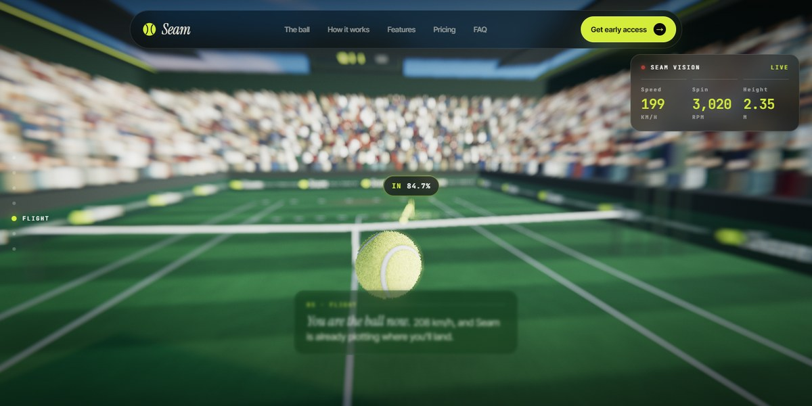

# Seam AI Tennis Coach Page

A near-black page for an AI tennis coach told from the ball's point of view: a 1300vh scroll-driven three.js film dives through the felt, the seam and the strings, rides a serve over the net with a live speed-and-spin readout and calls it in, then hands over to tennis-lime product sections.

**Open it:** [`index.html`](index.html) runs straight from disk — one file, every asset inlined, no build step. [Live demo](https://instalanding.ai/demos/seam-ai-tennis-coach.html) · [Page on InstaLanding](https://instalanding.ai/prompt/seam-ai-tennis-coach-page)

**The prompt:** [`PROMPT.md`](PROMPT.md) is this same file with a short instruction on top: keep the design, replace the brand and copy, convert to your stack. Paste it into Claude Code, Cursor, ChatGPT or any builder and it builds this page.

| | |
| --- | --- |
| Best for | sports tech and fitness apps, AI products with a computer-vision story, consumer hardware and app launches, scroll-story product reveals |
| Style | dark, webgl, scroll-driven, serif-display, lime-accent, cinematic |
| Sections | nav → story → manifesto → showcase → how-it-works → features → stats → app → pricing → faq → cta → footer |
| Libraries | three.js, bundled and minified inside the file (no CDN) |
| Fonts | Instrument Serif, Inter Tight, JetBrains Mono |
| Uses | webgl, canvas-2d, inline-svg, reduced-motion |
| Size | 743 KB · prompt ~190,414 tokens |

Every region is tagged `data-section`, and the file opens with a header comment that maps its design tokens, sections and scripts, and lists what breaks when you edit it. Read that first.

The brand, copy, numbers and testimonials on this page are fictional. Replace them before you ship.
