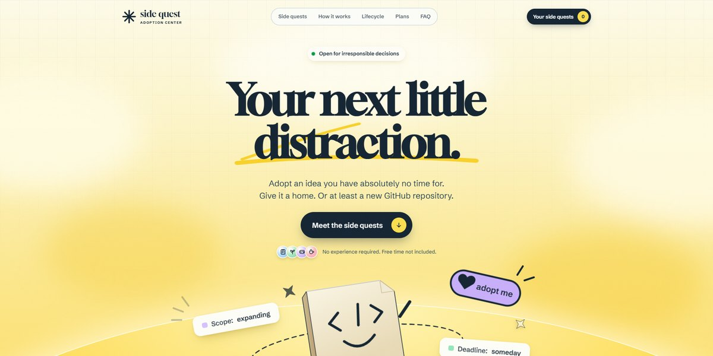

# Side Quest Adoption Center Page

A butter-yellow adoption center for ideas you have no time for: a waving page mascot, six illustrated side quests to adopt with confetti, and a lifecycle from spark to archive.

**Open it:** [`index.html`](index.html) runs straight from disk — one file, every asset inlined, no build step. [Live demo](https://instalanding.ai/demos/side-quest-adoption.html) · [Page on InstaLanding](https://instalanding.ai/prompt/side-quest-adoption-center-page)

**The prompt:** [`PROMPT.md`](PROMPT.md) is this same file with a short instruction on top: keep the design, replace the brand and copy, convert to your stack. Paste it into Claude Code, Cursor, ChatGPT or any builder and it builds this page.

| | |
| --- | --- |
| Best for | playful consumer apps, community and indie maker products, idea boards and marketplaces, launch pages with a sense of humour |
| Style | light, playful, illustrated, svg, warm, interactive |
| Sections | nav → hero → stats → ideas → how-it-works → lifecycle → testimonials → pricing → faq → footer |
| Libraries | none — plain HTML, CSS and JS |
| Fonts | Gloock, Schibsted Grotesk (Google Fonts) |
| Uses | inline-svg, inlined-images, reduced-motion |
| Size | 99 KB · prompt ~25,523 tokens |

Every region is tagged `data-section`, and the file opens with a header comment that maps its design tokens, sections and scripts, and lists what breaks when you edit it. Read that first.

The brand, copy, numbers and testimonials on this page are fictional. Replace them before you ship.
