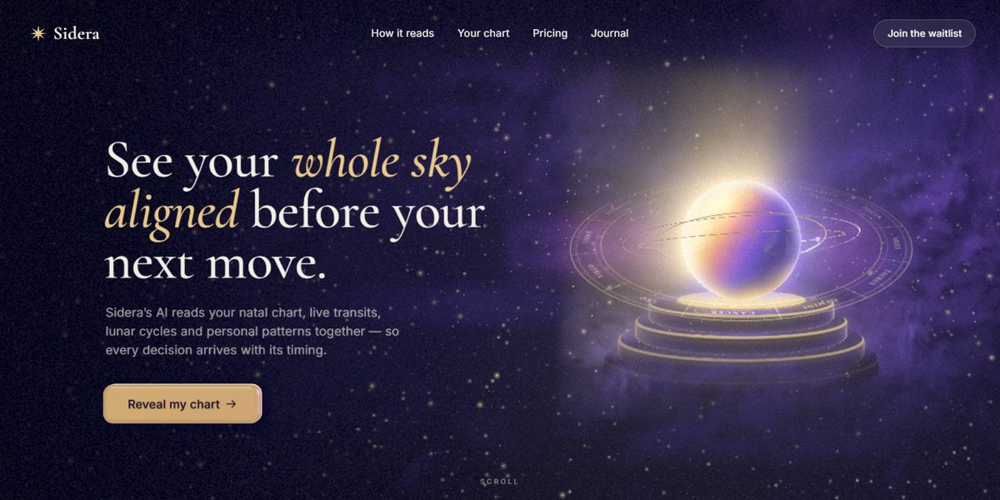

# Sidera AI Astrology Page

A midnight-and-gold page for an AI astrologer: a Three.js orb of gold and violet glass sits on an obsidian podium inside a turning zodiac wheel and gold astrolabe rings, wrapped in nebula smoke and bloom, while the headline and CTA are redrawn as refracting 3D glass; below, a live natal chart per sun sign, today's real moon phase and a stars-to-pricing landing page.

**Open it:** [`index.html`](index.html) runs straight from disk — one file, every asset inlined, no build step. [Live demo](https://instalanding.ai/demos/sidera-ai-astrology.html) · [Page on InstaLanding](https://instalanding.ai/prompt/sidera-ai-astrology-page)

**The prompt:** [`PROMPT.md`](PROMPT.md) is this same file with a short instruction on top: keep the design, replace the brand and copy, convert to your stack. Paste it into Claude Code, Cursor, ChatGPT or any builder and it builds this page.

| | |
| --- | --- |
| Best for | astrology and wellness apps, consumer AI products, subscription apps with a waitlist, premium mystical brands |
| Style | dark, webgl, three-js, glassmorphism, luxury |
| Sections | nav → hero → marquee → how-it-reads → daily-reading → features → moon → principles → pricing → journal → faq → waitlist → footer |
| Libraries | three 0.169.0 |
| Fonts | Inter, Cormorant Garamond (Google Fonts) |
| Uses | canvas-2d, inline-svg, reduced-motion |
| Size | 134 KB · prompt ~34,459 tokens |

Every region is tagged `data-section`, and the file opens with a header comment that maps its design tokens, sections and scripts, and lists what breaks when you edit it. Read that first.

## Built on

- [3D scene by Shakuro](https://shakuro.com) — The hero's orb, podium and glass UI scene, credited in the page footer

Keep this attribution if you redistribute the component; the original's own terms apply to the parts taken from it.

The brand, copy, numbers and testimonials on this page are fictional. Replace them before you ship.
