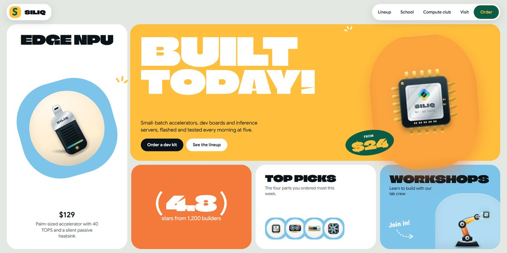

# Siliq AI Hardware Lab Page

A sticker-bright bento for a small-batch AI hardware lab and school: SVG chips and GPUs, a hero board that breaks apart into a honey flood and a gallery that folds into a grid.

**Open it:** [`index.html`](index.html) runs straight from disk — one file, every asset inlined, no build step. [Live demo](https://instalanding.ai/demos/siliq-lab.html) · [Page on InstaLanding](https://instalanding.ai/prompt/siliq-ai-hardware-lab-page)

**Build it yourself:** [`PROMPT.md`](PROMPT.md) is the one-shot brief this file was built from. Paste it into any AI builder or coding agent.

| | |
| --- | --- |
| Best for | AI hardware and devices, maker shops and electronics stores, workshops, classes and schools, playful product brands |
| Style | light, bento, playful, illustrated, gsap, scroll-driven |
| Sections | nav → hero → story → products → school → process → gallery → team → reviews → pricing → faq → contact → footer |
| Libraries | gsap 3.13.0, lenis 1.3.4 |
| Fonts | Climate Crisis, Google Sans, Playpen Sans (Google Fonts) |
| Uses | inline-svg, reduced-motion |
| Size | 762 KB · brief ~1,093 tokens |

Every region is tagged `data-section`, and the file opens with a header comment that maps its design tokens, sections and scripts, and lists what breaks when you edit it. Read that first.

The brand, copy, numbers and testimonials on this page are fictional. Replace them before you ship.
