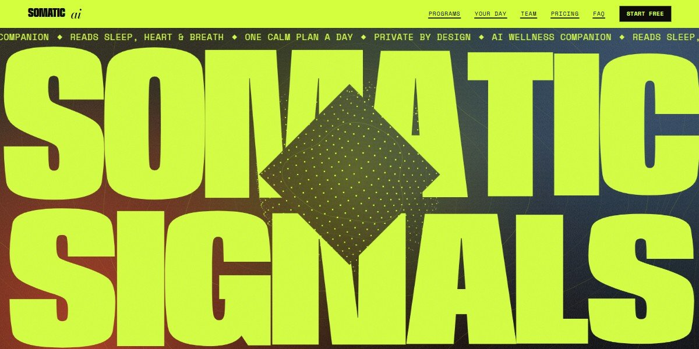

# Somatic AI Wellness Companion Page

An acid-lime page for an AI wellness companion: a breathing point-sphere orb sits behind "SOMATIC SIGNALS" stretched to the full width, a diamond window opens to fill the screen as you scroll, five programs slide past sideways, and every heart trace, sleep map and portrait is drawn in code.

**Open it:** [`index.html`](index.html) runs straight from disk — one file, every asset inlined, no build step. [Live demo](https://instalanding.ai/demos/somatic-ai-wellness.html) · [Page on InstaLanding](https://instalanding.ai/prompt/somatic-ai-wellness-companion-page)

**Build it yourself:** [`PROMPT.md`](PROMPT.md) is the one-shot brief this file was built from. Paste it into any AI builder or coding agent.

| | |
| --- | --- |
| Best for | AI health and wellness apps, wearables and sleep tracking, digital health startups, consumer AI companions |
| Style | acid, bold-type, stretched-type, canvas, scroll-driven, horizontal-scroll |
| Sections | nav → hero → about → runs → values → week → crew → voices → steps → gallery → season → membership → faq → contact → footer |
| Libraries | gsap 3.13.0, lenis 1.3.4 |
| Fonts | Anybody, Bodoni Moda, Space Grotesk, Space Mono (Google Fonts) |
| Uses | canvas-2d, inline-svg, inlined-images, reduced-motion |
| Size | 85 KB · brief ~1,746 tokens |

Every region is tagged `data-section`, and the file opens with a header comment that maps its design tokens, sections and scripts, and lists what breaks when you edit it. Read that first.

The brand, copy, numbers and testimonials on this page are fictional. Replace them before you ship.
