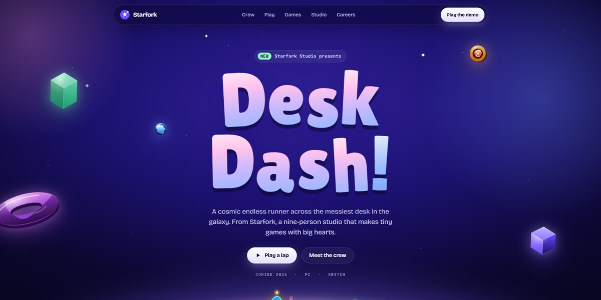

# Starfork Game Studio Landing Page

A premium indie game studio page in a cosmic toy world, with eight sprite-rigged characters on a glowing planet and a playable 30-second endless runner.

**Open it:** [`index.html`](index.html) runs straight from disk — one file, every asset inlined, no build step. [Live demo](https://instalanding.ai/demos/starfork-studio.html) · [Page on InstaLanding](https://instalanding.ai/prompt/starfork-game-studio-landing-page)

**The prompt:** [`PROMPT.md`](PROMPT.md) is this same file with a short instruction on top: keep the design, replace the brand and copy, convert to your stack. Paste it into Claude Code, Cursor, ChatGPT or any builder and it builds this page.

| | |
| --- | --- |
| Best for | game studios and indie games, playful product launches, interactive brand pages, careers and recruiting pages |
| Style | dark, playful, cosmic, characters, sprite-animation, interactive |
| Sections | nav → hero → crew → play → games → studio → careers → footer |
| Libraries | none — plain HTML, CSS and JS |
| Fonts | Bricolage Grotesque, JetBrains Mono, Lilita One (Google Fonts) |
| Uses | inline-svg, reduced-motion |
| Size | 165 KB · prompt ~42,174 tokens |

Every region is tagged `data-section`, and the file opens with a header comment that maps its design tokens, sections and scripts, and lists what breaks when you edit it. Read that first.

The brand, copy, numbers and testimonials on this page are fictional. Replace them before you ship.
