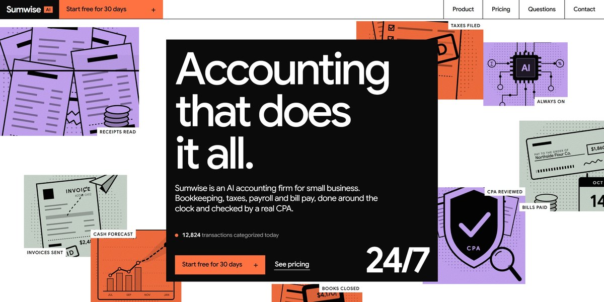

# Sumwise AI Accounting Firm Page

A print-shop page for an AI accounting firm: an ink cover opens to full screen as eight duotone illustration tiles fly out and back, a sample monthly close walks itself through, halftone dots resolve into each service, a chat replays an AI answering from the books, and the tax year scrolls past on a pinned track.

**Open it:** [`index.html`](index.html) runs straight from disk — one file, every asset inlined, no build step. [Live demo](https://instalanding.ai/demos/sumwise-ai-accounting.html) · [Page on InstaLanding](https://instalanding.ai/prompt/sumwise-ai-accounting-firm-page)

**Build it yourself:** [`PROMPT.md`](PROMPT.md) is the one-shot brief this file was built from. Paste it into any AI builder or coding agent.

| | |
| --- | --- |
| Best for | fintech and accounting, small-business SaaS, AI services firms, professional services |
| Style | duotone, editorial, svg-illustration, bold-color, scroll-driven |
| Sections | nav → hero → statement → monthly → services → everything → ask → switching → tax-year → stories → accountants → faq → pricing → contact → footer |
| Libraries | gsap 3.13.0, lenis 1.3.27 |
| Fonts | system fonts only |
| Uses | inline-svg, inlined-images, reduced-motion |
| Size | 155 KB · brief ~1,152 tokens |

Every region is tagged `data-section`, and the file opens with a header comment that maps its design tokens, sections and scripts, and lists what breaks when you edit it. Read that first.

The brand, copy, numbers and testimonials on this page are fictional. Replace them before you ship.
