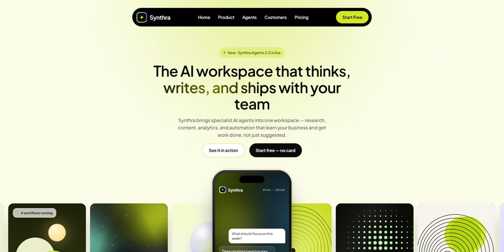

# Synthra AI Workspace Page

A bright lime SaaS page for an AI workspace of specialist agents: a phone running a live chat stands over a ticker of generative art tiles, then dark grainy cards with mesh gradients and glass panels carry the features, six sticky customer stories, pricing, six glowing agent orbs and a rotating 3D ring of product tiles.

**Open it:** [`index.html`](index.html) runs straight from disk — one file, every asset inlined, no build step. [Live demo](https://instalanding.ai/demos/synthra-ai-workspace.html) · [Page on InstaLanding](https://instalanding.ai/prompt/synthra-ai-workspace-page)

**The prompt:** [`PROMPT.md`](PROMPT.md) is this same file with a short instruction on top: keep the design, replace the brand and copy, convert to your stack. Paste it into Claude Code, Cursor, ChatGPT or any builder and it builds this page.

| | |
| --- | --- |
| Best for | AI SaaS and agent platforms, productivity and workspace tools, B2B startups with pricing tiers, AI assistant launches |
| Style | light, glassmorphism, mesh-gradient, generative-art, 3d-css |
| Sections | nav → hero → partners → features → customer-stories → pricing → agents → testimonials → faq → cta → footer |
| Libraries | none — plain HTML, CSS and JS |
| Fonts | Plus Jakarta Sans, JetBrains Mono (Google Fonts) |
| Uses | inline-svg, inlined-images, reduced-motion |
| Size | 72 KB · prompt ~18,600 tokens |

Every region is tagged `data-section`, and the file opens with a header comment that maps its design tokens, sections and scripts, and lists what breaks when you edit it. Read that first.

The brand, copy, numbers and testimonials on this page are fictional. Replace them before you ship.
