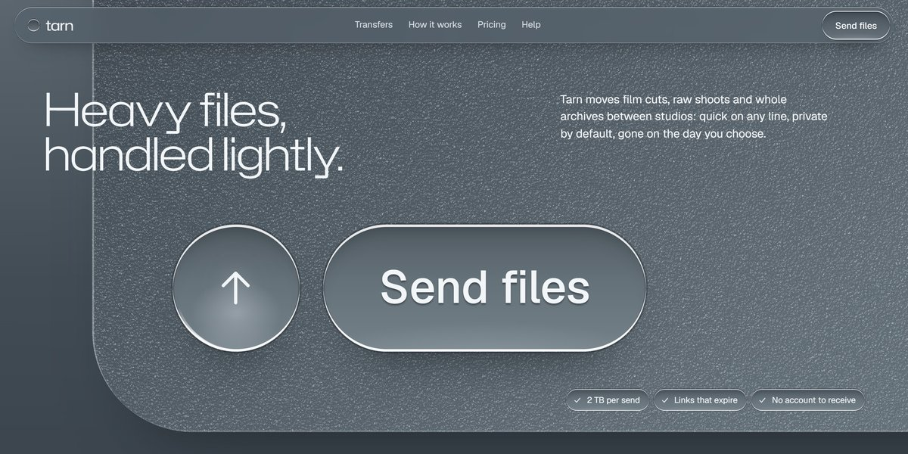

# Tarn File Transfer Page

A frosted steel-grey page for a heavy-file transfer service: the hero zooms out of a giant glass send button into its frame, a magnifying lens glides across the manifesto, a light sweeps the service tiles, and a send button you can try with your own file.

**Open it:** [`index.html`](index.html) runs straight from disk — one file, every asset inlined, no build step. [Live demo](https://instalanding.ai/demos/tarn-file-transfer.html) · [Page on InstaLanding](https://instalanding.ai/prompt/tarn-file-transfer-page)

**Build it yourself:** [`PROMPT.md`](PROMPT.md) is the one-shot brief this file was built from. Paste it into any AI builder or coding agent.

| | |
| --- | --- |
| Best for | file transfer and storage products, creative and media tools, B2B SaaS for studios, developer and infrastructure tools |
| Style | glassmorphism, monochrome, frosted, svg-illustration, scroll-driven |
| Sections | nav → hero → manifesto → services → process → speed → demo → work → pricing → voices → faq → contact → footer |
| Libraries | gsap 3.13.0, lenis 1.3.4 |
| Fonts | Geist, Hubot Sans (Google Fonts) |
| Uses | inline-svg, reduced-motion |
| Size | 622 KB · brief ~1,359 tokens |

Every region is tagged `data-section`, and the file opens with a header comment that maps its design tokens, sections and scripts, and lists what breaks when you edit it. Read that first.

## Built on

- [8B AI Website Builder](https://8b.com/) — Generated this page from a single prompt

Keep this attribution if you redistribute the component; the original's own terms apply to the parts taken from it.

The brand, copy, numbers and testimonials on this page are fictional. Replace them before you ship.
