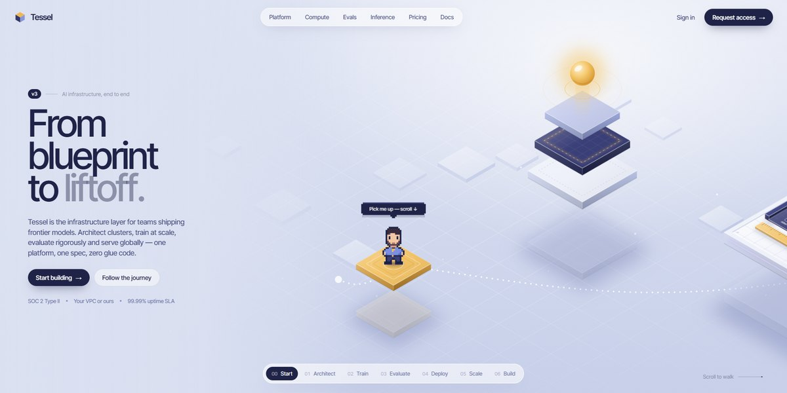

# Tessel AI Infrastructure Page

A pinned isometric journey for an AI infrastructure platform: a pixel-art engineer walks a glowing route past six code-drawn scenes, from blueprint table to rocket launch, as chapter cards and a rail follow the scroll.

**Open it:** [`index.html`](index.html) runs straight from disk — one file, every asset inlined, no build step. [Live demo](https://instalanding.ai/demos/tessel-ai-infrastructure.html) · [Page on InstaLanding](https://instalanding.ai/prompt/tessel-ai-infrastructure-page)

**The prompt:** [`PROMPT.md`](PROMPT.md) is this same file with a short instruction on top: keep the design, replace the brand and copy, convert to your stack. Paste it into Claude Code, Cursor, ChatGPT or any builder and it builds this page.

| | |
| --- | --- |
| Best for | AI infrastructure and MLOps platforms, developer tools with a step-by-step story, cloud and compute products, scroll-driven product tours |
| Style | light, isometric, pixel-art, svg, scroll-driven, interactive |
| Sections | nav → story → cta |
| Libraries | none — plain HTML, CSS and JS |
| Fonts | Inter Tight (Google Fonts) |
| Uses | inline-svg, inlined-images, reduced-motion |
| Size | 80 KB · prompt ~20,602 tokens |

Every region is tagged `data-section`, and the file opens with a header comment that maps its design tokens, sections and scripts, and lists what breaks when you edit it. Read that first.

The brand, copy, numbers and testimonials on this page are fictional. Replace them before you ship.
