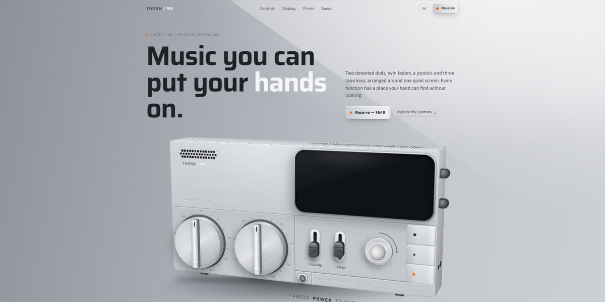

# Thorn Music Controller Page

A desktop music controller built in CSS 3D from layered DOM: every dial, fader, joystick and tape key works, with clicks you can hear and three finishes.

**Open it:** [`index.html`](index.html) runs straight from disk — one file, every asset inlined, no build step. [Live demo](https://instalanding.ai/demos/thorn-controller.html) · [Page on InstaLanding](https://instalanding.ai/prompt/thorn-music-controller-page)

**The prompt:** [`PROMPT.md`](PROMPT.md) is this same file with a short instruction on top: keep the design, replace the brand and copy, convert to your stack. Paste it into Claude Code, Cursor, ChatGPT or any builder and it builds this page.

| | |
| --- | --- |
| Best for | consumer hardware and audio products, product pre-orders and reservations, industrial design studios, interactive product showcases |
| Style | light, 3d, skeuomorphic, interactive, product, no libraries |
| Sections | nav → hero → controls → display → finish → specs → cta → footer |
| Libraries | none — plain HTML, CSS and JS |
| Fonts | system fonts only |
| Uses | inline-svg, inlined-fonts, inlined-images, reduced-motion |
| Size | 168 KB · prompt ~42,935 tokens |

Every region is tagged `data-section`, and the file opens with a header comment that maps its design tokens, sections and scripts, and lists what breaks when you edit it. Read that first.

The brand, copy, numbers and testimonials on this page are fictional. Replace them before you ship.
