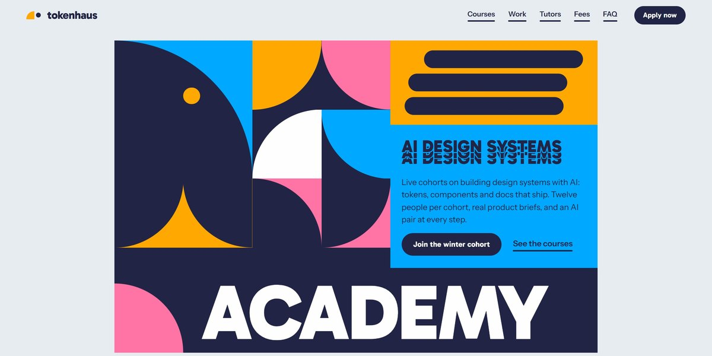

# tokenhaus AI Design System Academy Page

A four-ink Bauhaus page for an AI design-systems academy: the hero is a grid of quarter-circle tiles that turn as the next section slides over it, "SYSTEM" fans out into echoes in pink, amber and white, courses grow out of circles into pills, and every swatch, specimen and tutor portrait is drawn in SVG.

**Open it:** [`index.html`](index.html) runs straight from disk — one file, every asset inlined, no build step. [Live demo](https://instalanding.ai/demos/tokenhaus-design-academy.html) · [Page on InstaLanding](https://instalanding.ai/prompt/tokenhaus-ai-design-system-academy-page)

**Build it yourself:** [`PROMPT.md`](PROMPT.md) is the one-shot brief this file was built from. Paste it into any AI builder or coding agent.

| | |
| --- | --- |
| Best for | online courses and cohorts, design and education brands, AI tools for designers, bootcamps and academies |
| Style | bauhaus, geometric, bold-color, svg-illustration, scroll-driven |
| Sections | nav → hero → about → courses → manifesto → work → process → tutors → numbers → voices → fees → faq → contact → footer |
| Libraries | gsap 3.13.0, lenis 1.3.4 |
| Fonts | Gabarito, Instrument Sans (Google Fonts) |
| Uses | inline-svg, reduced-motion |
| Size | 74 KB · brief ~1,284 tokens |

Every region is tagged `data-section`, and the file opens with a header comment that maps its design tokens, sections and scripts, and lists what breaks when you edit it. Read that first.

The brand, copy, numbers and testimonials on this page are fictional. Replace them before you ship.
