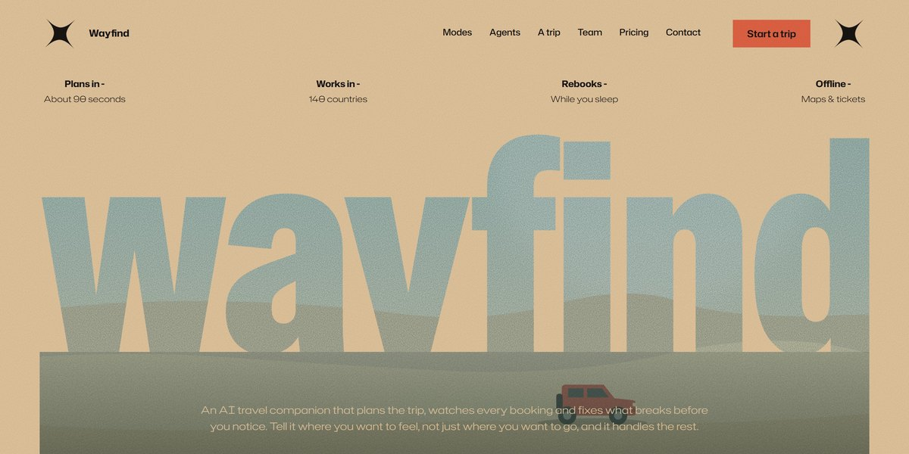

# Wayfind AI Travel Companion Page V2

A sand-and-sea expedition poster of a page for an AI travel companion: "wayfind" is cut out of a desert photo that opens to full bleed as you scroll, mode posters stack and tilt, a nine-day route draws itself sideways, and every photo is raymarched live in WebGL.

**Open it:** [`index.html`](index.html) runs straight from disk — one file, every asset inlined, no build step. [Live demo](https://instalanding.ai/demos/wayfind-ai-travel-v2.html) · [Page on InstaLanding](https://instalanding.ai/prompt/wayfind-ai-travel-companion-page-v2)

**The prompt:** [`PROMPT.md`](PROMPT.md) is this same file with a short instruction on top: keep the design, replace the brand and copy, convert to your stack. Paste it into Claude Code, Cursor, ChatGPT or any builder and it builds this page.

| | |
| --- | --- |
| Best for | travel and booking apps, AI agents and assistants, consumer subscription apps, outdoor and adventure brands |
| Style | editorial, expedition-poster, knockout-type, webgl, scroll-driven |
| Sections | nav → hero → manifesto → modes → agents → itinerary → disruptions → team → reviews → gallery → pricing → faq → contact → footer |
| Libraries | gsap 3.13.0, lenis 1.3.4 |
| Fonts | Hubot Sans, Special Gothic (Google Fonts) |
| Uses | webgl, canvas-2d, inline-svg, inlined-images, reduced-motion |
| Size | 170 KB · prompt ~43,799 tokens |

Every region is tagged `data-section`, and the file opens with a header comment that maps its design tokens, sections and scripts, and lists what breaks when you edit it. Read that first.

The brand, copy, numbers and testimonials on this page are fictional. Replace them before you ship.
