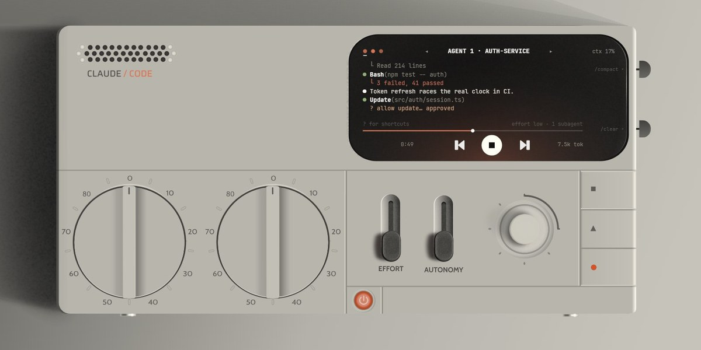

# Agent Terminal · product

Hardware concept · Decoded Rive · Canvas 2D · one HTML file

A desk-radio controller for coding agents: three agent sessions run on its screen while real dials, sliders and tape keys set effort, autonomy, thinking budget, subagents and plan mode.

**Use it:** [instalanding.ai/products/agent-terminal](https://instalanding.ai/products/agent-terminal) — or open `index.html` from disk. Every control works.

## Files

| File | What it is |
| --- | --- |
| [`index.html`](index.html) | The product: one file, every asset inlined, opens from disk. |

## Controls

| Control | What it does |
| --- | --- |
| POWER | Boots the screen; ▶ then runs all three agents |
| SKIP KEYS | Switch between the auth-service, api-gateway and docs agents |
| EFFORT | Low to max: longer thinking before each step |
| AUTONOMY | Ask first, auto edits or full auto; low asks before every edit |
| DIALS | One sets the thinking budget (off to 64k tokens), the other the subagents (×1 to ×8) |
| TAPE KEYS | Accept edits, plan mode (edits skipped), or stop all agents |
| SIDE KEYS | /compact shrinks the context; /clear starts the session over |
| JOYSTICK | Scrolls the transcript |

## Tags

hardware, agents, skeuomorphic, interactive.

## Built on

- A fan concept, not an Anthropic product. Claude and Claude Code are trademarks of Anthropic; this demo isn't affiliated with or endorsed by Anthropic.
