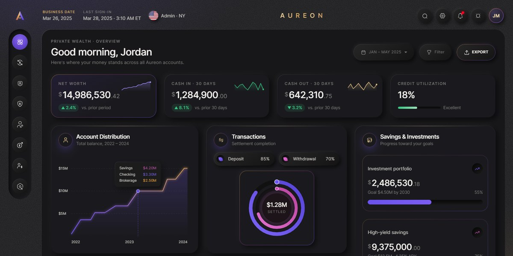

# Aureon Wealth Dashboard · product

Web app · HTML, CSS & SVG · no libraries · one HTML file

A dark private-wealth dashboard: net worth and cash-flow cards with sparklines, a balance chart you can scrub, settlement rings, savings goals and an allocation card, with date ranges that re-count every figure, a CSV export and a light theme.

**Use it:** [instalanding.ai/products/aureon-dashboard](https://instalanding.ai/products/aureon-dashboard) — or open `index.html` from disk. Every control works.

## Files

| File | What it is |
| --- | --- |
| [`index.html`](index.html) | The product: one file, every asset inlined, opens from disk. |

## Controls

| Control | What it does |
| --- | --- |
| DATE RANGE | Jan–May 2025, last 12 months or 2024: every figure counts to the new value and the charts redraw |
| FILTER | Show income, outflow or both in the cash-flow chart, and toggle the month markers |
| EXPORT | Downloads the selected range as a CSV |
| BALANCE CHART | Move the pointer along it to read savings, checking and brokerage at any point |
| THEME | Switches between the dark and light themes |
| SIDEBAR | Expands to show labels; on phones it becomes a drawer |
| SEARCH · BELL · AVATAR | Open the search field, the notifications and the profile menu |

## Tags

dashboard, fintech, dark, interactive.

## Built on

- Aureon is a fictional bank; the accounts, figures and people are invented.
