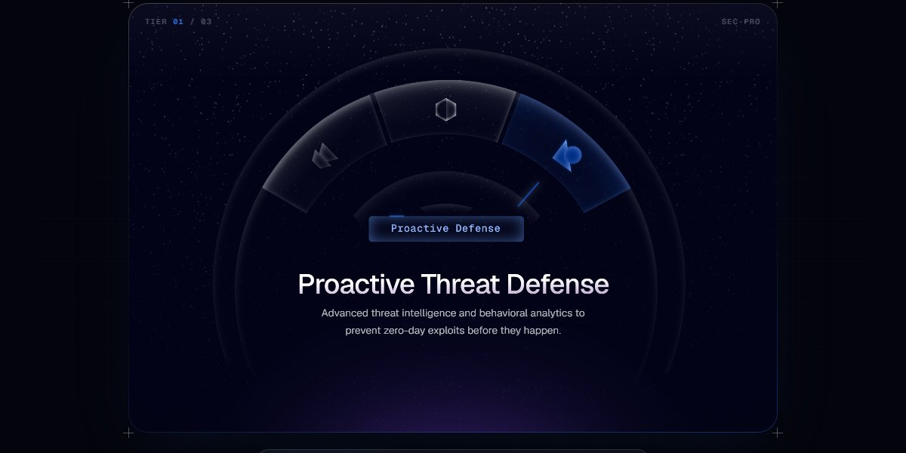

# Bastion Threat Protection Tiers · product

Web app UI · Decoded Rive · Canvas 2D · no libraries · one HTML file

A tier picker for a cybersecurity service, set on a dark glass card: an arc gauge with three lit segments where a needle swings to Proactive, Adaptive or Essential, the shield icon glows, the copy below rewrites itself and the whole scene re-lights in that tier's blue, orange or violet.

**Use it:** [instalanding.ai/products/bastion-tiers](https://instalanding.ai/products/bastion-tiers) — or open `index.html` from disk. Every control works.

## Files

| File | What it is |
| --- | --- |
| [`index.html`](index.html) | The product: one file, every asset inlined, opens from disk. |

## Controls

| Control | What it does |
| --- | --- |
| PROACTIVE · ADAPTIVE · ESSENTIAL | The tabs under the card pick a tier: the needle swings to its segment, the headline and copy change and the accent colour follows |
| HOVER A TAB | Lights that tier's segment on the arc before you commit |
| ARC SEGMENTS | Hover a segment on the gauge itself to light it, and click it to select that tier |
| ← · → | The arrow keys step through the tiers, wrapping round at either end |
| TIER READOUT | The corners of the card show the tier number and its code (SEC·PRO, SEC·ADP, SEC·ESS) |

## Tags

cybersecurity, pricing, tiers, gauge, dark, interactive.

## Built on

- Bastion is a fictional brand.
- Geist and Geist Mono by Vercel, under the SIL Open Font License.
