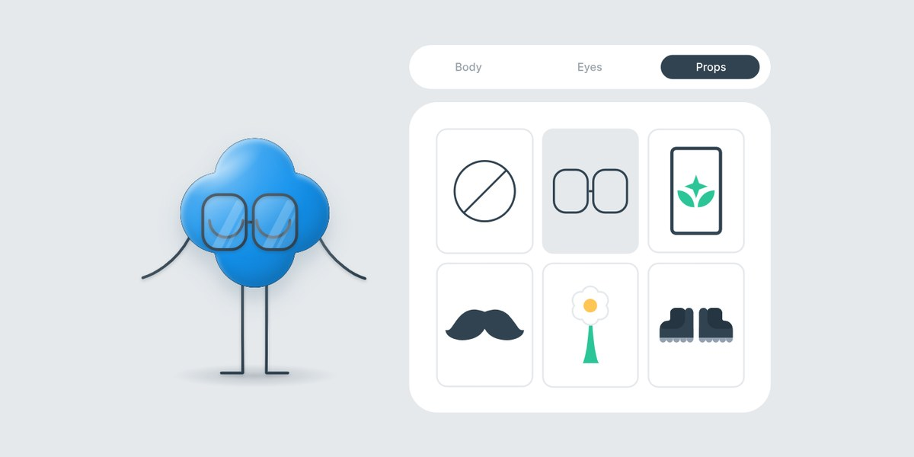

# Character Creator · product

App UI · Decoded Rive · Canvas 2D · one HTML file

A playful avatar builder: a glossy little character on the left and a tabbed panel on the right, where every pick, from body colour and shape to eyes and props, animates onto the character as you tap it.

**Use it:** [instalanding.ai/products/character-creator](https://instalanding.ai/products/character-creator) — or open `index.html` from disk. Every control works.

## Files

| File | What it is |
| --- | --- |
| [`index.html`](index.html) | The product: one file, every asset inlined, opens from disk. |

## Controls

| Control | What it does |
| --- | --- |
| BODY · EYES · PROPS | The tab bar switches the panel; the active tab slides into a dark pill |
| COLOUR | Green, blue or yellow; the shape buttons and the flower prop follow the colour |
| SHAPE | Square, pentagon, circle, bow tie, flower or two pills |
| EYES | Default, happy, closed or wink |
| PROPS | None, glasses, phone, moustache, flower or sneakers |

## Tags

avatar, playful, onboarding, interactive.
