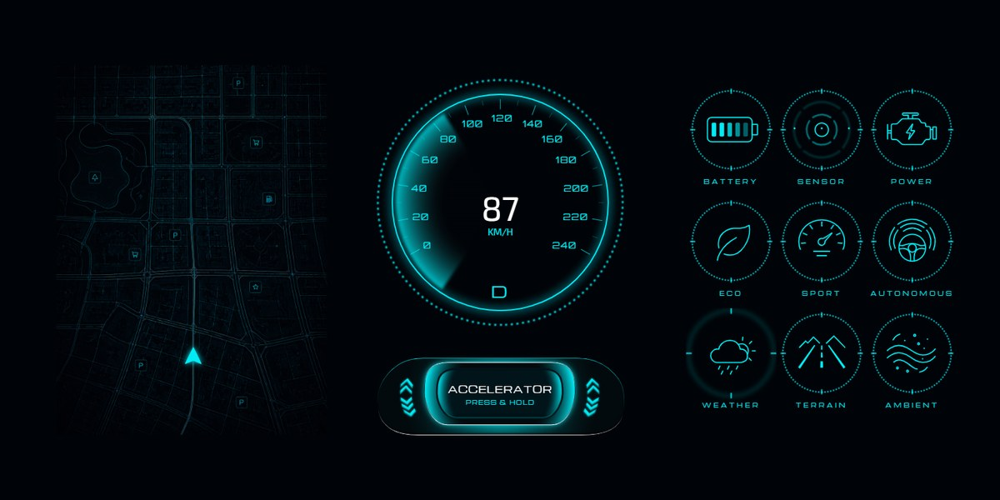

# Futuristic Driving UI · product

Automotive HMI · Decoded Rive · Canvas 2D · one HTML file

A glowing in-car dashboard concept: press LAUNCH and a speedometer, a live map and nine mode tiles power up, hold the accelerator to climb toward 240 km/h, and pick Eco, Sport or Autonomous to recolor the whole cockpit.

**Use it:** [instalanding.ai/products/driving-ui](https://instalanding.ai/products/driving-ui) — or open `index.html` from disk. Every control works.

## Files

| File | What it is |
| --- | --- |
| [`index.html`](index.html) | The product: one file, every asset inlined, opens from disk. |

## Controls

| Control | What it does |
| --- | --- |
| LAUNCH | Starts the car: the speedometer, the map and the mode tiles animate in |
| ACCELERATOR | Press and hold: the gear drops from N into D and the speed climbs toward 240 km/h; let go and it eases back down |
| ECO | Turns the cockpit green and swaps the map |
| SPORT | Turns the cockpit orange and swaps the map |
| AUTONOMOUS | Turns the cockpit violet and swaps the map |
| STATUS TILES | Battery, sensor, power, weather, terrain and ambient show the car's state; the sensor sweeps and the weather tile glows |

## Tags

automotive, hud, neon, interactive.
