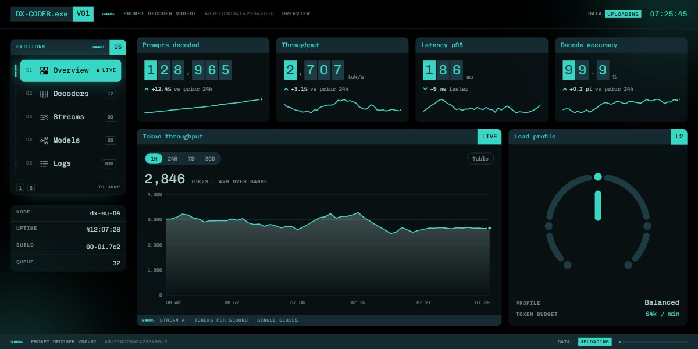

# DX-Coder Decoder Console · product

Web app UI · HTML + CSS + SVG · no libraries · one HTML file

A teal-on-black ops console for a prompt-decoding service, with five live sections: rolling-digit KPIs and a token-throughput chart, a decoder fleet with a scrolling bitstream and hex frame inspector, three regional streams and a request heatmap, model routing with its latency histogram, and a filterable decode log.

**Use it:** [instalanding.ai/products/dx-coder-console](https://instalanding.ai/products/dx-coder-console) — or open `index.html` from disk. Every control works.

## Files

| File | What it is |
| --- | --- |
| [`index.html`](index.html) | The product: one file, every asset inlined, opens from disk. |

## Controls

| Control | What it does |
| --- | --- |
| SECTIONS · 1–5 | The side rail switches between Overview, Decoders, Streams, Models and Logs; the number keys jump straight to one, and the arrow keys walk the rail |
| 1H · 24H · 7D · 30D | Re-draws the token-throughput chart and its average for that range; hover the chart for a crosshair and the exact value |
| TABLE | Swaps in a data table under the throughput chart |
| LOAD PROFILE GAUGE | Click a dot (or use ← →) to set the profile from Eco to Max; the needle swings and the token budget updates |
| DECODER FLEET | Click a decoder to attach the bitstream view to its channel; click a bitstream column to lock the scanner on it, and click it again to release |
| BATCH SIZE − + | Steps the batch size with rolling digits |
| MODEL ROUTING | Click V0 or CX to route traffic; the latency histogram and the comparison table follow the selected model |
| ALL · INF · WRN · ERR | Filters the live decode log by level |

## Tags

dashboard, ops console, data viz, monospace, dark, interactive.

## Built on

- DX-Coder is a fictional product.
- Chivo Mono by Omnibus-Type, under the SIL Open Font License.
