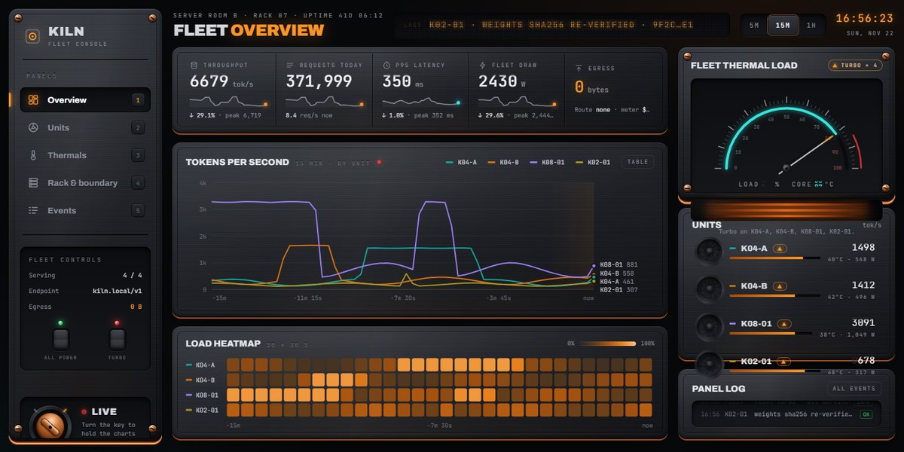

# Kiln Fleet Console · product

Web app · HTML, CSS & SVG · no libraries · one HTML file

A machined-hardware console for a rack of on-premise AI servers: live throughput, latency, power and heat across four units, a thermal gauge, a load heatmap, a rack you can pull units from and a network-boundary view, all driven by rocker switches and a key.

**Use it:** [instalanding.ai/products/kiln-dashboard](https://instalanding.ai/products/kiln-dashboard) — or open `index.html` from disk. Every control works.

## Files

| File | What it is |
| --- | --- |
| [`index.html`](index.html) | The product: one file, every asset inlined, opens from disk. |

## Controls

| Control | What it does |
| --- | --- |
| PANELS · 1–5 | Overview, Units, Thermals, Rack & boundary and Events; the number keys switch them too |
| ALL POWER · TURBO | Rocker switches for the whole fleet: turbo multiplies throughput and heat, and the gauge swings toward red |
| UNIT ROCKERS | Each unit panel has its own power and turbo switches |
| LIVE KEY | Turn the key to freeze the charts in place, turn it back to resume |
| 5M · 15M · 1H | Sets how much history the charts show |
| FOCUS A UNIT | Pick a unit (in the list or the rack) to focus every chart on it; Escape clears it |
| LOG FILTERS | All events, warnings only, or the focused unit |
| CHARTS | Hover any chart for the exact readings at that moment |

## Tags

dashboard, hardware, ai infra, interactive.

## Built on

- A companion to the Machine Front Panel page and the Kiln design system (instalanding.ai/systems/kiln): the same machined look and amber. Kiln is fictional; every reading is simulated in the browser.
