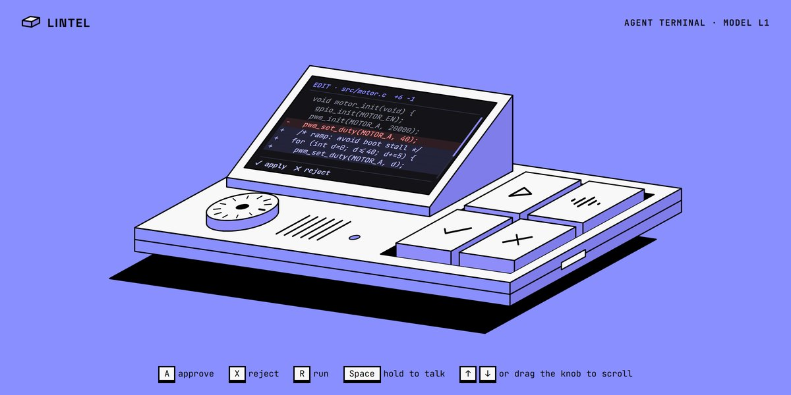

# Lintel L1 Agent Terminal · product

Hardware concept · Isometric SVG · Web Audio · no libraries · one HTML file

A periwinkle desk terminal for a coding agent, drawn in isometric SVG: approve or reject its edit to a rover's motor firmware on the tilted screen, hold the talk key to ask for a revision, then run it to build and flash and watch the serial log, with keys that sink and click and a knob that scrolls the screen.

**Use it:** [instalanding.ai/products/lintel-terminal](https://instalanding.ai/products/lintel-terminal) — or open `index.html` from disk. Every control works.

## Files

| File | What it is |
| --- | --- |
| [`index.html`](index.html) | The product: one file, every asset inlined, opens from disk. |

## Controls

| Control | What it does |
| --- | --- |
| APPROVE · A | Applies the agent's edit to src/motor.c; after a good flash it commits the change |
| REJECT · X | Discards the edit, and the screen asks you to tell the agent what to change |
| TALK · HOLD SPACE | After a reject or a commit, hold to speak: a live waveform and your words on screen; release and the agent sends back a revised edit or starts a new task |
| RUN · R | Once applied, builds and flashes the board with a progress bar, then shows the serial boot log |
| KNOB · ↑ ↓ | Drag it round, scroll the wheel over it or use the arrow keys to scroll the screen, one detent click per line |
| KEYS | Sink with the original key-press curves and click with the original sound; Tab reaches each one and Enter or Space presses it |
| STATUS LED | Blinks while building, pulses while listening and stays lit when the board is flashed |

## Tags

agent terminal, isometric, svg, keyboard, sound, coding agent.

## Built on

- Lintel is a fictional brand.
- The key click is the sound from the source .riv, and the key travel follows its animation curves.
- Space Grotesk and JetBrains Mono from Google Fonts, under the SIL Open Font License.
