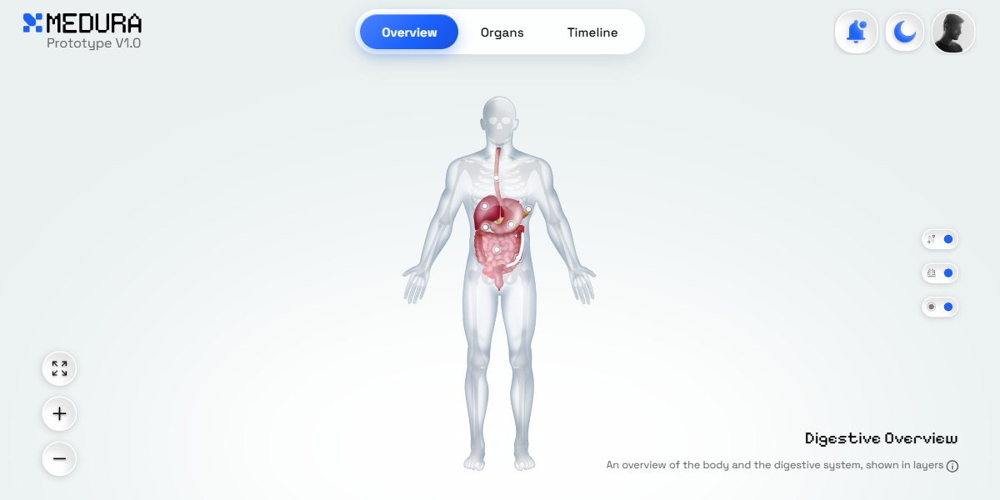

# Medura Anatomy Explorer · product

Health app · Decoded Rive · Canvas 2D · no libraries · one HTML file

A soft, clinical-white anatomy app for the digestive system: a translucent body you can light up point by point and peel back in layers, a row of organ cards that open wide on hover, and a five-step timeline that follows a meal from swallowing to the end, with a dark mode and a focus view.

**Use it:** [instalanding.ai/products/medura-anatomy](https://instalanding.ai/products/medura-anatomy) — or open `index.html` from disk. Every control works.

## Files

| File | What it is |
| --- | --- |
| [`index.html`](index.html) | The product: one file, every asset inlined, opens from disk. |

## Controls

| Control | What it does |
| --- | --- |
| OVERVIEW · ORGANS · TIMELINE | The pill tabs switch the three views; the blue indicator slides to the one you pick |
| BODY POINTS | Hover a point on the digestive tract to light it, click to select it |
| LAYER SWITCHES | The three switches on the right show or hide the digestive path, the organs and the skeleton |
| ZOOM · FOCUS | + and − zoom the body; the corner button hides the header for a full-screen view |
| ORGAN CARDS | Hover a card (gallbladder, large intestine, stomach, liver, pancreas) and it opens wide to show the organ |
| TIMELINE | Drag the slider or pick a dot to step through swallowing, the esophagus, the stomach, absorption and forming stool |
| MOON · LOGO | The moon switches dark mode; the logo opens the About dialog |

## Tags

health, anatomy, education, interactive.

## Built on

- Medura is the brand name the source prototype shipped with, kept as is. The anatomy is illustrative, not medical advice.
