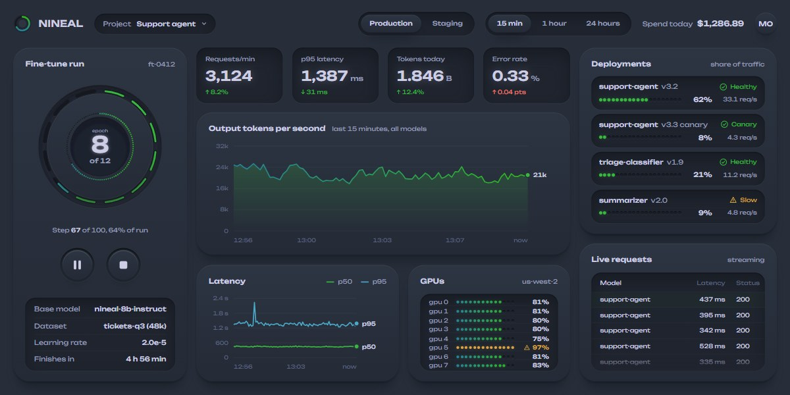

# Nineal Support Agent Console · product

Web app UI · HTML + CSS + SVG · no libraries · one HTML file

A soft, slate-blue console for running an AI support agent in production: a fine-tune run on a dial of twelve epochs you can pause or stop, live requests, latency, tokens and error rate, an output-tokens chart, a GPU fleet, deployments with their share of traffic and a streaming request log, all switchable between production and staging.

**Use it:** [instalanding.ai/products/nineal-console](https://instalanding.ai/products/nineal-console) — or open `index.html` from disk. Every control works.

## Files

| File | What it is |
| --- | --- |
| [`index.html`](index.html) | The product: one file, every asset inlined, opens from disk. |

## Controls

| Control | What it does |
| --- | --- |
| PRODUCTION · STAGING | Swaps the whole console between environments: traffic, latency and error rate, the deployments and their traffic shares, the GPU region and the request log |
| 15 MIN · 1 HOUR · 24 HOURS | Re-draws the output-tokens and latency charts for that range |
| PAUSE · PLAY | Pauses or resumes the fine-tune run; the dial, step count, finish time and loss curve follow |
| STOP | Stops the run and resets it to epoch 1, clearing the loss curve; play starts it again |
| HOVER A CHART | Shows a crosshair and the exact value at that moment |
| LIVE READOUTS | Requests, tokens, spend, GPU load and the request log keep streaming in real time |

## Tags

dashboard, llm ops, fine-tuning, data viz, dark, interactive.

## Built on

- Nineal is a fictional product.
- Unbounded by NaN, under the SIL Open Font License.
