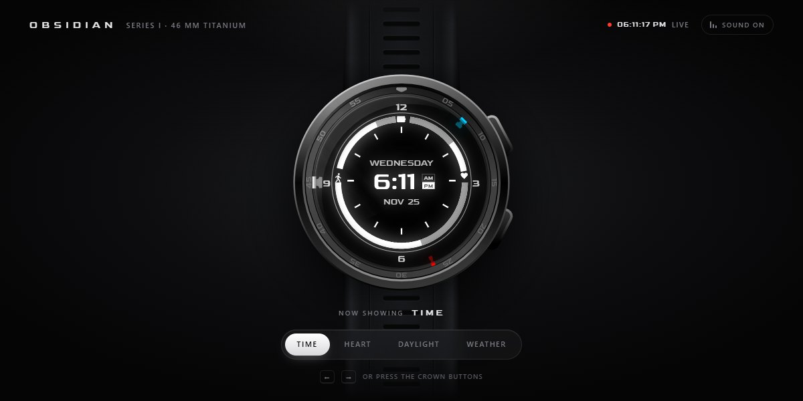

# Obsidian Series I Smartwatch · product

Hardware concept · Decoded Rive · Canvas 2D · no libraries · one HTML file

A titanium smartwatch on a studio-lit black set, with a face you can actually work: press the crown buttons to move between the real time, a live heart rate and step count, daylight and the weather, each change playing the watch's own transition, with a click you can hear and a crystal glare that follows your pointer.

**Use it:** [instalanding.ai/products/obsidian-watch](https://instalanding.ai/products/obsidian-watch) — or open `index.html` from disk. Every control works.

## Files

| File | What it is |
| --- | --- |
| [`index.html`](index.html) | The product: one file, every asset inlined, opens from disk. |

## Controls

| Control | What it does |
| --- | --- |
| CROWN BUTTONS | Press the upper button to go forward a screen and the lower one to go back; each press clicks and buzzes on phones |
| ← · → | The arrow keys (or A and D) do the same as the crown buttons |
| TIME · HEART · DAYLIGHT · WEATHER | The tabs under the watch jump straight to a screen, stepping through the transitions in between |
| TIME | Your real local time, day and date, with AM and PM |
| HEART | A heart rate that drifts between 62 and 86 BPM and a step count that keeps climbing |
| SOUND | Turns the two-tick button click on or off |
| POINTER | Move it around the watch and the glare on the crystal swings toward it |

## Tags

wearable, hardware, dark, interactive.

## Built on

- Obsidian is a fictional brand; the heart rate, steps and weather are simulated in the browser. The Goldman font is under the SIL Open Font License.
