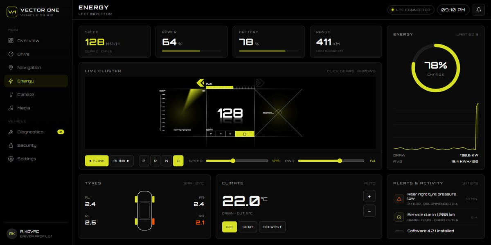

# Vector One Vehicle Dashboard · product

Automotive HMI · Decoded Rive cluster · Canvas 2D · no libraries · one HTML file

A black-and-lime in-car overview screen: a live instrument cluster with blinkers, gear select, speedometer, power bar and a radar sweep, wrapped in cards for speed, battery, range, energy, tyres, climate and alerts that all follow the car as you drive it.

**Use it:** [instalanding.ai/products/vector-one-dashboard](https://instalanding.ai/products/vector-one-dashboard) — or open `index.html` from disk. Every control works.

## Files

| File | What it is |
| --- | --- |
| [`index.html`](index.html) | The product: one file, every asset inlined, opens from disk. |

## Controls

| Control | What it does |
| --- | --- |
| GEARS · P R N D | Click a gear on the cluster or below it (or press P, R, N, D): the yellow block slides over and the letter grows |
| BLINKERS | Click a chevron or ◀ BLINK / BLINK ▶ (Q and E, or the arrow keys); both at once reads as hazards |
| SPEED | The slider (or ↑ / ↓) sets a target; the speedometer eases to it over 1.5s and the speed card follows |
| PWR | Fills the power bar; the energy draw, sparkline, battery and range react |
| CLIMATE | + and − set the cabin temperature; A/C, SEAT and DEFROST toggle |
| SIDEBAR | Picks a section; it becomes an icon rail on tablets and a drawer on phones |

## Tags

automotive, dashboard, dark, interactive.

## Built on

- Vector One is a fictional car and OS; every reading is simulated in the browser.
