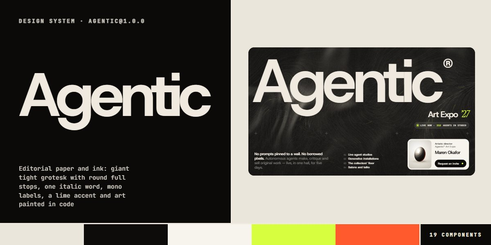

# Agentic · design system

`agentic@1.0.0` · 19 components · 52 tokens · light

An editorial language for events, galleries, studios and creative-tech launches: warm paper and near-black panels inset 10px with 30px corners, Host Grotesk set huge and tight with a round full stop on every title, one Instrument Serif italic word per heading, JetBrains Mono labels, and a single lime accent that floods each pill button on hover. There are no image files: every picture is a canvas painted by a seeded generative engine (satin, liquid chrome, engraved topography, a glass orb, stone busts, ridgelines, plotted petals, flow fields) in six palettes, finished with vignette and grain. Extracted from the Agentic Art Expo page.

The full board, every component at once: [preview.jpg](preview.jpg)

**Explore it live:** [instalanding.ai/systems/agentic](https://instalanding.ai/systems/agentic) — every component rendered, a token playground and COPY FOR AGENT.

## Files

| File | What it is |
| --- | --- |
| [`specimen.html`](specimen.html) | Every component live in one file. Each is a `<section data-component>`; the markup inside `.sp-demo` is the component. Opens from disk. |
| [`tokens.css`](tokens.css) | The design tokens as CSS custom properties (`--ag-*`). |
| [`agentic.css`](agentic.css) | Tokens plus every component's CSS, scoped under `.ag` with `ag-` class names, so it can't restyle anything else on your page. |

## Use it

1. Load the fonts: `<link rel="stylesheet" href="https://fonts.googleapis.com/css2?family=Host+Grotesk:wght@400..700&family=Instrument+Serif:ital@0;1&family=JetBrains+Mono:wght@400;500&display=swap">`
2. Link `agentic.css` and wrap the part of your page that uses the system in `
`.
3. Copy components from `specimen.html`. Interactive ones need the small script in its `<script id="ag-components-js">`, and any that draw SVG art need its `<svg id="ag-defs">`.
4. Change the look by editing the tokens, not the components.

## Components

- Header
- Buttons & links
- Titles & section heads
- Hero frame
- Generative art
- Person card
- Exhibit cards
- Statement
- Programme accordion
- Reasoning figure
- Timeline
- Review marquee
- Figures bento
- Tickets
- Press list
- FAQ accordion
- Journal posts
- Invitation panel
- Footer

## Conventions

**Typography**

- Display is Host Grotesk 600, set huge and tight: .ag-title at --ag-t-giant with -.058em tracking and line-height .88, .ag-h2 at --ag-t-h2 with -.05em. Giant titles carry .ag-dot, which draws a round full stop after the text; h2-sized heads end in a typed full stop instead.
- One word or phrase per heading switches to Instrument Serif italic (.ag-it), never more. Labels, dates and chips are JetBrains Mono at --ag-label, 500, uppercase, +.06em (.ag-mono).
- Body is Host Grotesk at --ag-text, line-height 1.5; ledes are 500 weight at --ag-lede with -.025em tracking, and secondary text is --ag-muted. Wordmarks are sized from their container: font-size calc(100cqw / --ag-len * 2.1) on a container-type: inline-size parent.

**Color**

- Warm paper (--ag-bg) with lighter cards (--ag-surface) and near-black ink. Dark panels (--ag-panel, text --ag-on-panel) sit inset --ag-frame from the edge with --ag-r-xl corners; their secondary text and rules use --ag-panel-muted and --ag-panel-line.
- Muted text, hairlines and image placeholders are derived with color-mix in oklab (--ag-muted, --ag-line, --ag-shade), so editing the core recolours them; never add new greys.
- Lime (--ag-accent) is the only accent: the dot inside every button, the live pill, plan badges and dots on dark, the italic year. Ember (--ag-ember) only appears on hover, as the dot after an exhibit name.

**Layout & pictures**

- Sections pad with --ag-space and a --ag-gutter side margin (.ag-wrap); a section head (.ag-sec-head) is a two-column grid of title and a 360px muted lede that stacks under 760px.
- Every picture is <canvas class="ag-art" data-ag-art data-ag-pal data-ag-seed> inside a sized, rounded parent; never an image file. Kinds: silk, chrome, contour, orb, bust, ridge, petal, flow. Palettes: night, bone, ember, violet, lime, ash. Portraits are busts; the same seed always paints the same picture.
- Buttons are pills: .ag-btn (ink), .ag-btn--light (on dark panels), .ag-btn--sm (headers and cards). Accordions use data-ag-accordion / data-ag-acc-item / data-ag-acc-btn / data-ag-acc-panel with a round .ag-icon-btn plus.

**Motion**

- Everything eases on --ag-ease (cubic-bezier(.7,0,.2,1)). A button's lime dot scales 90x over --ag-dur-open to flood it; links underline from the left over --ag-dur-line; accordions open with a grid-rows transition.
- Canvases paint lazily near the viewport, a time-sliced slice per frame, and fade in over --ag-dur-paint. The hero satin breathes (18s), grain steps every 1.2s, the live dot pulses and the review marquee loops at 38px/s, all only while on screen.
- With prefers-reduced-motion every loop and transition stops, the marquee wraps and the particle layer never starts; every component is complete without motion.

**Accessibility**

- Decorative canvases are aria-hidden; a canvas that carries meaning gets role="img" and an aria-label. The marquee's copies are aria-hidden with their links out of the tab order.
- Accordions are real buttons with aria-expanded; the ticket switch is a labelled group of buttons with aria-pressed; the burger has a visually hidden label and aria-controls.
- Focus is a 2px ink outline offset 3px. Body text stays at --ag-ink or --ag-muted on paper and --ag-on-panel or --ag-panel-muted on dark.

## Extracted from

- [Agentic Art Expo Page](../../pages/agentic-art-expo-page) · [live](https://instalanding.ai/demos/agentic-art-expo.html)

Every system is extracted from a real, working page: the components are its markup, not a redraw.

MIT.
