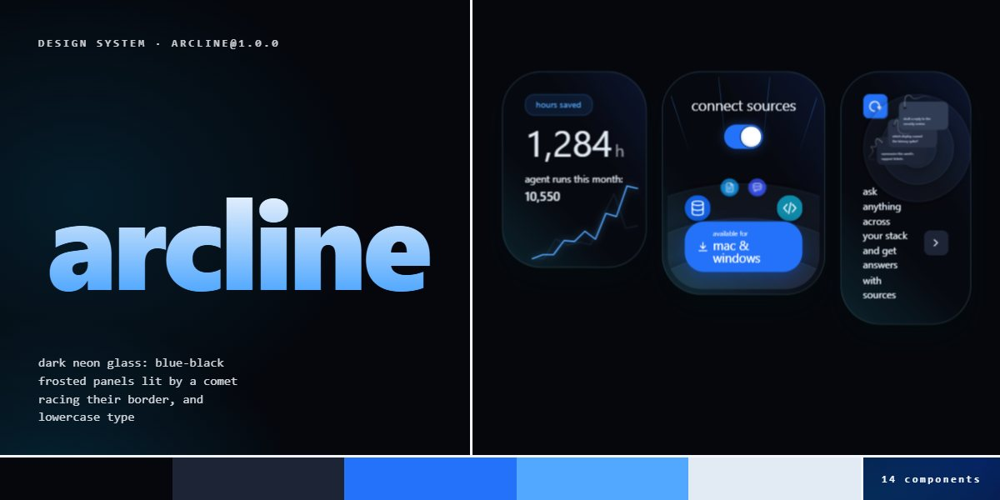

# Arcline · design system

`arcline@1.0.0` · 14 components · 69 tokens · dark

Blue-black frosted glass on a near-black ramp that warms toward blue, panels whose border is lit by two comets racing around it before neon corner lights flicker on, a chat bar that opens into a breathing voice orb, and everything set lowercase on a platform face. Extracted from the Neon Glass App landing page.

The full board, every component at once: [preview.jpg](preview.jpg)

**Explore it live:** [instalanding.ai/systems/arcline](https://instalanding.ai/systems/arcline) — every component rendered, a token playground and COPY FOR AGENT.

## Files

| File | What it is |
| --- | --- |
| [`specimen.html`](specimen.html) | Every component live in one file. Each is a `<section data-component>`; the markup inside `.sp-demo` is the component. Opens from disk. |
| [`tokens.css`](tokens.css) | The design tokens as CSS custom properties (`--ac-*`). |
| [`arcline.css`](arcline.css) | Tokens plus every component's CSS, scoped under `.ac` with `ac-` class names, so it can't restyle anything else on your page. |

## Use it

1. Load the fonts: `<link rel="stylesheet" href="https://fonts.googleapis.com/css2?family=Poppins:wght@300;400;500;600&display=swap">`
2. Link `arcline.css` and wrap the part of your page that uses the system in `
`.
3. Copy components from `specimen.html`. Interactive ones need the small script in its `<script id="ac-components-js">`, and any that draw SVG art need its `<svg id="ac-defs">`.
4. Change the look by editing the tokens, not the components.

## Components

- Navigation
- Headline & section head
- Buttons
- Chat bar & voice orb
- Neon glass widgets
- Feature cards
- Step cards
- Stats strip
- Code panel
- Pricing plans
- FAQ
- Closing panel
- Sign-up modal
- Footer

## Conventions

**Typography**

- One family, a platform stack led by Poppins (--ac-font), at weight 300-400; headlines are never bold. Everything inside .ac is text-transform: lowercase to match the wordmark; code (.ac-code pre, .ac-code__title) keeps its real casing, and new code-like content needs the same exemption.
- The h1 is one display line (--ac-display, 3.75em on phones) in a gradient from --ac-gray50 to --ac-blue-hi clipped to the text. Section heads are a blue-tint eyebrow chip (.ac-eyebrow) over a centred 2.25-2.75em title and a light grey lede.
- Sizes are em-based off --ac-text-base (clamp 12-16px) on the root, so a component scales with its container's font-size.

**Layout**

- Sections sit in a 72em column (--ac-page-max) with 7.5em above each; the header and footer use 56.5em, the hero widgets 48em.
- Grids are one column on phones and go to three (features, steps, plans) or four (stats) columns from 768px; the developer row is 1fr / 1.25fr.
- The page is dark only: a near-black ground (--ac-gray900) washed by two large off-centre radial gradients in --ac-hue1 and --ac-hue2, never a flat black.

**Neon glass**

- Every surface is a glass panel: a 1px --ac-glass-border, --ac-glass-blur behind it, two faint diagonal hue gradients over a 60% near-black, and --ac-shadow-panel. Radius comes from --ac-panel-r per kind (widget 4em, stats and modal 3em, plan 2.5em, card 2em, FAQ row 1.5em).
- Light lives on the edge, as separate aria-hidden layers inside each panel: .ac-sheen, .ac-sweep, .ac-sweep--bloom, then .ac-shine and .ac-glow (top, bottom, bright). Keep all nine spans in that order on any new panel; they ignite only under .ac-reveal.ac-is-visible, .ac-widget or .ac-modal.ac-open.
- Colour is one blue family (--ac-blue, -hi, -lo, -tint, -line); the edge lights read --ac-hue1 (224) and --ac-hue2 (196), so turning those two numbers re-lights every panel.

**Motion**

- A panel enters by rising 1.5em over --ac-dur-reveal on --ac-ease-out-sine, then two comets race its border once (--ac-sweep-dur, --ac-ease-sweep), a sheen crosses the face (--ac-dur-sheen) and the corner lights flicker on after --ac-corner-lead. Stagger panels with --ac-fx-base and transition-delay inline.
- Hover changes are colour only, over --ac-trans-dur; the voice orb's circles orbit on coprime durations so the pattern never repeats.
- Under prefers-reduced-motion the sweep and sheen are hidden, the corner lights are simply on (opacity 1), reveals are instant and the orb stops.

**Accessibility**

- Light layers and decorative circles are aria-hidden; graphs and illustrations are role="img" with a label that says what they show.
- The chat bar's states are CSS on real controls: a required text input and hidden checkboxes behind labels, so keep `required` and the hidden inputs. Switches are checkboxes with role="switch" and a visually hidden label.
- The mobile menu button and its close button are labelled buttons; Escape closes the menu. FAQ rows are native 
.

## Extracted from

- [Neon Glass App Landing Page](../../pages/neon-glass-app-landing-page) · [live](https://instalanding.ai/demos/arcline-neon-glass.html)

Every system is extracted from a real, working page: the components are its markup, not a redraw.

MIT.
