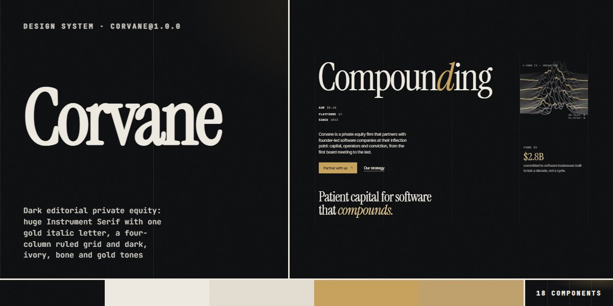

# Corvane · design system

`corvane@1.0.0` · 18 components · 53 tokens · dark

A quiet, expensive language for private equity, investment firms, family offices, advisory and other high-trust financial brands: ink and ivory with gold and champagne accents, Instrument Serif set huge with one gold italic letter (and one italic phrase per heading), Inter Tight for text and JetBrains Mono caps for every label. Every sheet draws a four-column ruled grid behind itself and lays its copy on the same columns; sections switch tone (dark, ivory, bone, gold), which re-points the rule, soft-text and accent tokens. Pictures are drawn in code: a live topo ridgeline canvas, generated data visuals, seeded partner portraits and office tiles with live clocks. Square 2px buttons wipe in two bands; a gross / net ledger, criteria bars and a full-width wordmark footer complete it. Extracted from the Corvane Capital Private Equity page.

The full board, every component at once: [preview.jpg](preview.jpg)

**Explore it live:** [instalanding.ai/systems/corvane](https://instalanding.ai/systems/corvane) — every component rendered, a token playground and COPY FOR AGENT.

## Files

| File | What it is |
| --- | --- |
| [`specimen.html`](specimen.html) | Every component live in one file. Each is a `<section data-component>`; the markup inside `.sp-demo` is the component. Opens from disk. |
| [`tokens.css`](tokens.css) | The design tokens as CSS custom properties (`--cv-*`). |
| [`corvane.css`](corvane.css) | Tokens plus every component's CSS, scoped under `.cv` with `cv-` class names, so it can't restyle anything else on your page. |

## Use it

1. Load the fonts: `<link rel="stylesheet" href="https://fonts.googleapis.com/css2?family=Instrument+Serif:ital@0;1&family=Inter+Tight:wght@300..600&family=JetBrains+Mono:wght@400;500&display=swap">`
2. Link `corvane.css` and wrap the part of your page that uses the system in `
`.
3. Copy components from `specimen.html`. Interactive ones need the small script in its `<script id="cv-components-js">`, and any that draw SVG art need its `<svg id="cv-defs">`.
4. Change the look by editing the tokens, not the components.

## Components

- Header
- Buttons & links
- Tones, rules & headings
- Hero & topo window
- Firm chart & figures
- Strategy theses
- Principles field
- Value-creation steps
- Partner portraits
- Quote & portfolio
- Office tiles & clocks
- Sector index
- Criteria bars
- Track-record ledger
- FAQ
- Insight list
- Contact form
- Footer & wordmark

## Conventions

**Typography**

- Display and headings are Instrument Serif 400, never bold, with tight tracking (-.02em to -.035em) and line-height .84-1. The hero word (.cv-giant) is sized from --cv-len (its character count) to fill three columns, and exactly one letter is <em>, set italic in --cv-gold. Every other heading (h2 at --cv-display) turns one phrase italic in the tone's accent (--cv-acc).
- Text is Inter Tight: body at --cv-body, leads (.cv-lead) at --cv-lead in weight 300; muted copy uses .cv-soft. Big numbers (facts, fund size, criteria, ledger) are the serif in --cv-gold-hi on dark, tabular.
- Every label, eyebrow, index, HUD corner, date and table head is JetBrains Mono caps at --cv-label / --cv-label-sm / --cv-micro with .1-.16em tracking. Eyebrows (.cv-eyebrow) sit behind a 22px accent rule.

**Color & tones**

- Every section sets data-cv-tone: dark (--cv-ink, ivory text), ivory (--cv-ivory), bone (--cv-bone) or gold (the champagne field, --cv-champ). The tone re-points --cv-rule, --cv-soft, --cv-acc and --cv-chip, so components never hard-code a line or muted colour: use those four.
- Gold (--cv-gold) is the accent on dark: the primary button, the hero's italic letter, gold lines in every drawing, criteria bars and focus rings; --cv-gold-hi is for figures and clocks. On ivory and bone the accent turns --cv-bronze and buttons turn ink; on the gold field the accent is ink.
- Alternate tones down the page (dark, ivory, gold, ivory, dark, bone ...) rather than repeating one. Green (--cv-live) only marks a fund that is investing.

**Grid & shapes**

- Every section is a .cv-sheet: it pads with --cv-sp / --cv-pad and draws the ruled field behind itself (1px --cv-rule lines at 0, 25, 50, 75 and 100%; two columns under 760px). Lay content with .cv-grid (four columns, each child padded by --cv-cell) so copy always starts on a rule.
- Corners are square: --cv-r is 2px on buttons, chips, frames and cards. Separation is hairlines (--cv-hairline in --cv-rule), not shadows; the only shadow is the faint card edge (--cv-shadow-card).
- Pictures are dark frames (.cv-frame on --cv-ink-2) holding inline SVG drawn in code, with mono labels in the corners and one gold element each: data visuals, the chart, portraits seeded by name, office line drawings. The hero window is a canvas of 46 ridgelines, one in eleven gold.

**Motion**

- Everything eases on --cv-ease (cubic-bezier(.7,0,.2,1)). Buttons wipe two half-height bands in from opposite sides over --cv-dur-wipe; icon buttons and the Contact cell fill from below over --cv-dur-fill; links run their underline out and back over --cv-dur-pass.
- Live pieces move slowly and only while on screen: the topo ridgelines drift, strategy visuals float, pulse and spin, the about chart draws its gold line once, portfolio cards loop at 34px/s and pause on hover or focus, office clocks tick every second.
- With prefers-reduced-motion every loop and transition stops; the topo draws once, the chart is shown complete and the portfolio cards wrap.

**Accessibility**

- All generated pictures and decorative marks are aria-hidden; the menu button carries aria-controls, aria-expanded and a label that swaps between open and close, and Escape closes the menu.
- The gross / net switch is a labelled group of buttons with aria-pressed; FAQ rows are native details and summary; role chips are real radio inputs; the form's note is aria-live.
- Focus is a 1px gold outline offset 3px. Soft text keeps at least 56% of the tone's text colour; the gold field uses ink text and ink accents.

## Extracted from

- [Corvane Capital Private Equity Page](../../pages/corvane-capital-private-equity-page) · [live](https://instalanding.ai/demos/corvane-capital.html)

Every system is extracted from a real, working page: the components are its markup, not a redraw.

MIT.
