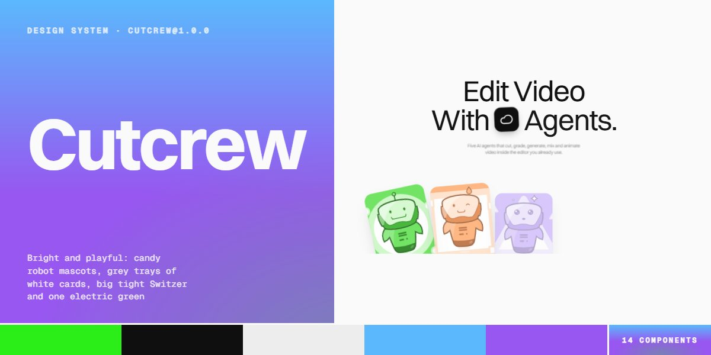

# Cutcrew · design system

`cutcrew@1.0.0` · 14 components · 77 tokens · light

A bright, playful language for AI agent products and creative tools: five candy-coloured robot mascots drawn in SVG that float in place on their own tinted tiles, grey trays with an 8px pad holding 24px-radius white cards, Switzer set large and tight at weight 400 with copy at 60% ink, dark --cc-d0 panels for anything that runs (a timeline strip with hover tooltips, a six-week gantt with a sweeping green playhead, an SDK card), and one electric green (#2BEE19) for status dots, timers, hot clips, checks and the glow every button picks up on hover. Motion is soft and springy: words blur in, cards rise in a fan, project covers fan out like a hand of cards, a team deck deals itself and a ring of covers turns in 3D. Extracted from the Cutcrew AI video agents page.

The full board, every component at once: [preview.jpg](preview.jpg)

**Explore it live:** [instalanding.ai/systems/cutcrew](https://instalanding.ai/systems/cutcrew) — every component rendered, a token playground and COPY FOR AGENT.

## Files

| File | What it is |
| --- | --- |
| [`specimen.html`](specimen.html) | Every component live in one file. Each is a `<section data-component>`; the markup inside `.sp-demo` is the component. Opens from disk. |
| [`tokens.css`](tokens.css) | The design tokens as CSS custom properties (`--cc-*`). |
| [`cutcrew.css`](cutcrew.css) | Tokens plus every component's CSS, scoped under `.cc` with `cc-` class names, so it can't restyle anything else on your page. |

## Use it

1. Load the fonts: `<link rel="stylesheet" href="https://fonts.googleapis.com/css2?family=Geist+Mono:wght@400;500&family=Inter:wght@400;500;600&display=swap">`
2. Link `cutcrew.css` and wrap the part of your page that uses the system in `
`.
3. Copy components from `specimen.html`. Interactive ones need the small script in its `<script id="cc-components-js">`, and any that draw SVG art need its `<svg id="cc-defs">`.
4. Change the look by editing the tokens, not the components.

## Components

- Buttons & chips
- Type & statement
- Hero agent fan
- Robot mascots
- Timeline strip
- Create modes accordion
- Services index
- Six-week gantt
- Project decks
- Team card deck
- Pricing & toggle
- FAQ accordion
- CTA cover ring
- Footer

## Conventions

**Typography**

- Switzer (Fontshare, https://api.fontshare.com/v2/css?f[]=switzer@400,500,600,700&display=swap; the stack falls back to Inter from fontsHref) carries everything at weight 400, large and tight: .cc-h1 (--cc-h1, 104px, -.03em) down to .cc-h6 (--cc-h6, 20px, weight 500). Headings are classes, not tags; the breakpoints step them down at 1199px and 809px.
- Copy is .cc-lead, .cc-p, .cc-ps and .cc-xs in --cc-t60; .cc-cap is 11px uppercase for labels. Quiet numbers and meta (01, 2026, + Open) go to --cc-t35. Geist Mono (--cc-font-mono) is only for code and the mono logos.
- A section head is .cc-head-row: an eyebrow (.cc-eyebrow with a dark .cc-chip icon square) over a .cc-h3 on the left, a short .cc-p and a grey button on the right. The statement line sets 60px words with tilted mascot slots (.cc-slot, --cc-r for the tilt) between them, its tail in --cc-t35.

**Trays, cards & colour**

- Lists live in trays: a --cc-g1 box (--cc-radius-tray, --cc-tray-pad inside, 8px gaps) holding --cc-white cards at --cc-radius-card, with 16px inner pieces (--cc-radius-inner). Stats, the create modes, services, team, plans, the FAQ and the footer are all trays.
- Anything that runs or plays is dark: --cc-d0 panels (timeline, gantt, team stage, the SDK stage, the services scope row) with --cc-d1 / --cc-d2 controls, --cc-wline hairlines and --cc-w / --cc-w60 text.
- Electric green (--cc-acc) is a signal, never a large fill on light ground: status dots, the live blink, timers, the playhead (--cc-acc2), the hot gantt clip, checks on --cc-accxl, the pricing switch, the button hover glow (--cc-glow) and the one green button per dark or colour panel. The candy tints (--cc-tint-*, --cc-accl) wash in behind covers on hover; the CTA alone is the sky-to-violet gradient.

**Mascots & art**

- The five agents are <symbol id="cc-agent-0..4"> in the shared <svg id="cc-defs"> (0 Cut green, 1 Hue orange, 2 Nova purple, 3 Echo blue, 4 Flow pink). Draw one inside any positioned box: 
<svg viewBox="0 0 200 200" preserveAspectRatio="xMidYMid slice"><use href="#cc-agent-0"/></svg>
. Copy #cc-defs once per page.
- Each mascot fills its own tinted square with a big pale shape (circle, square, triangle, hexagon, diamond) and floats on SMIL with a levitation trail; their colours are fixed in the symbol, so restyle the tile, not the robot.
- Covers and portraits are inline SVG too (.cc-art fills its box absolutely). Mascot tiles are framed white (--cc-frame or 3px) with --cc-shadow-deck / --cc-shadow-card; the hero fan tilts cards from -14 to 14 degrees and drops them by distance from the middle.

**Buttons & controls**

- Buttons are .cc-btn blocks at --cc-radius-btn (not pills): .cc-btn-dark is the default action, .cc-btn-gray secondary, .cc-btn-white and .cc-btn-acc on dark or colour panels, .cc-btn-sm in the nav. All lift 1px and glow green on hover.
- Icon controls are 36-44px rounded squares (.cc-tbtn, .cc-ibtn, .cc-tail, .cc-send), dark on dark panels, grey on light, turning green when they are the row's action (.cc-srow:hover .cc-tail).
- Toggles are real controls: the pricing .cc-toggle is role="switch" with aria-checked and turns its track green; FAQ rows are buttons with aria-expanded; team rows are buttons with aria-pressed; the create ways are focusable with aria-expanded.

**Motion**

- Springy and soft: big panels resize on --cc-ease-swift (the create ways over --cc-dur-open, the team deck over --cc-dur-deck), project covers fan out on --cc-ease-spring, the fan rises on --cc-ease-rise, the hero chip pops on --cc-ease-pop and words blur in over --cc-dur-word.
- Running parts loop slowly: the gantt playhead sweeps on --cc-dur-playhead, the logo marquee scrolls on --cc-dur-marquee, the CTA ring turns once every --cc-dur-ring, mascot tiles bob on --cc-dur-float. The create ways (8s), the team deck (5s) start only when they scroll into view.
- Under prefers-reduced-motion every CSS animation and transition stops, the SMIL mascots are paused with pauseAnimations(), nothing auto-advances and the prompt shows its brief in full.

**Accessibility**

- Mascots, covers and portraits are aria-hidden art; timeline tiles are focusable with an aria-label naming the agent, and focus shows the tooltip as hover does.
- Focus is a 2px --cc-d0 outline offset 3px (green on the timeline tiles). Copy on tints stays --cc-t; white copy only sits on --cc-d0 / --cc-d1 or under a dark scrim.
- The FAQ answer opens on a grid-template-rows transition so its height is real; closed rows keep their answer in the DOM for find-in-page.

## Extracted from

- [Cutcrew AI Video Agents Page](../../pages/cutcrew-ai-video-agents-page) · [live](https://instalanding.ai/demos/cutcrew-ai-video-agents.html)

Every system is extracted from a real, working page: the components are its markup, not a redraw.

MIT.
