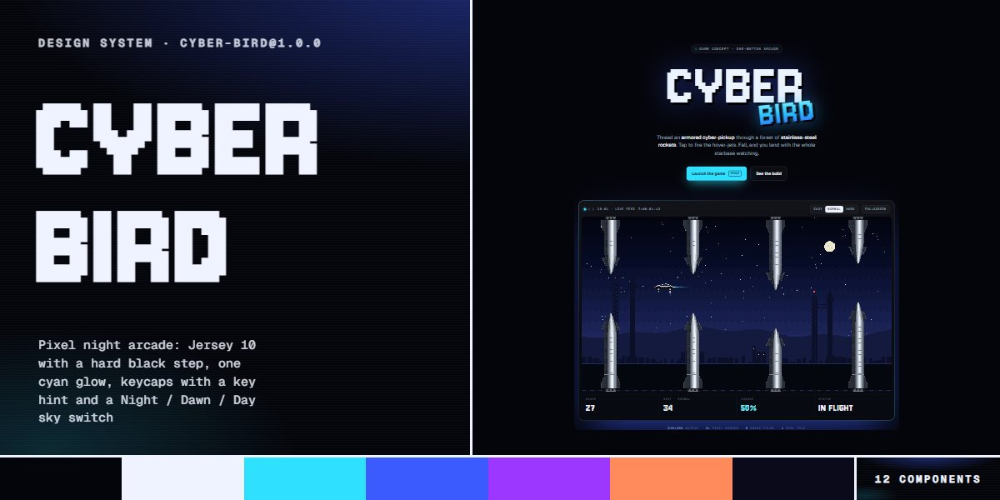

# Cyber Bird · design system

`cyber-bird@1.0.0` · 12 components · 79 tokens · dark

A dark arcade language for games, launches and playful AI products: a near-black night sky of drifting pixel stars, scanlines and an aura mixed from a glow pair, Jersey 10 pixel type with a hard black stepped shadow, one cyan accent, Geist for reading and Geist Mono capitals for every label. Buttons carry a mono key hint (SPACE); keycaps are Jersey 10 in a 3px ink border with a 4px black step. A Night / Dawn / Day switch sets data-cb-theme on the root, which swaps the glow pair every aura, console halo and card spotlight is mixed from and repaints the pixel skies. Every picture is drawn pixel by pixel in code by the template's own sprite module: the cyber-pickup, steel rocket stacks, jet smoke and three starbase skies. Extracted from the Cyber Bird arcade game page.

The full board, every component at once: [preview.jpg](preview.jpg)

**Explore it live:** [instalanding.ai/systems/cyber-bird](https://instalanding.ai/systems/cyber-bird) — every component rendered, a token playground and COPY FOR AGENT.

## Files

| File | What it is |
| --- | --- |
| [`specimen.html`](specimen.html) | Every component live in one file. Each is a `<section data-component>`; the markup inside `.sp-demo` is the component. Opens from disk. |
| [`tokens.css`](tokens.css) | The design tokens as CSS custom properties (`--cb-*`). |
| [`cyber-bird.css`](cyber-bird.css) | Tokens plus every component's CSS, scoped under `.cb` with `cb-` class names, so it can't restyle anything else on your page. |

## Use it

1. Load the fonts: `<link rel="stylesheet" href="https://fonts.googleapis.com/css2?family=Jersey+10&family=Geist:wght@400;500;600&family=Geist+Mono:wght@400;500&display=swap">`
2. Link `cyber-bird.css` and wrap the part of your page that uses the system in `
`.
3. Copy components from `specimen.html`. Interactive ones need the small script in its `<script id="cb-components-js">`, and any that draw SVG art need its `<svg id="cb-defs">`.
4. Change the look by editing the tokens, not the components.

## Components

- Night sky & scanlines
- Nav & sky switch
- Keycaps, buttons & chips
- Pixel display type
- Hero & game console
- Pixel ticker
- Feature bento
- Mode cards
- Flight manual
- Mission log
- Final call
- Footer

## Conventions

**Typography**

- Display is Jersey 10, a pixel face, always weight 400 and usually uppercase: the title at --cb-title (line-height .78), --cb-h2 section titles (.84), --cb-final for the closing word, card titles and telemetry at --cb-h3, keycaps at --cb-keycap. Never bold it and never set it below 26px.
- Big display type carries a hard black step, never a blur: text-shadow: var(--cb-step) var(--cb-step) 0 var(--cb-void) on .cb-h2, --cb-step-title on .cb-title (plus a soft glow mixed from --cb-glow). A second line in a head drops to --cb-dim with .
- Body is Geist 400 in --cb-muted with <strong>/<b> in --cb-ink at 500. Every label, tag, chip, badge, status bar and kicker is Geist Mono 500 in capitals at --cb-label or --cb-micro with .1-.18em tracking; kickers are --cb-accent-hi behind a 24px rule.

**Color & themes**

- Near-black --cb-bg with ink --cb-ink; one accent, --cb-accent cyan (hover --cb-accent-hi, text on it --cb-accent-ink). Everything else is glow: auras, the console halo, the stage behind sprites and the card spotlight are color-mix() of --cb-glow and --cb-glow2 into transparent.
- Themes are real: set data-cb-theme="night|dawn|day" on the .cb root (or press any [data-cb-set-theme] button, which the component script wires and keeps aria-pressed in sync). Night is the default; each theme swaps --cb-glow/--cb-glow2 to its --cb-<theme>-glow pair (registered with @property, so it fades over --cb-dur-glow) and repaints the pixel skies and star tint. The ground and ink stay dark in every theme.
- Surfaces are glass, not fills: cards use a faint top-lit white gradient over a --cb-line hairline; the nav is --cb-glass over --cb-blur; telemetry cells are --cb-panel; code sits in a --cb-well. Never add light grey panels.

**Pixels & pictures**

- Every picture is a <canvas class="cb-pix"> (image-rendering: pixelated) drawn by the component script from the template's Sprites module: data-cb-sprite="car" (42x15 truck), data-cb-sky="night|dawn|day" (a starbase sky at the canvas size), data-cb-scene="car|rocket|attract" (animated scenes; attract is the 640x360 game field in the root's theme) and data-cb-stars (the drifting starfield). Never use image files.
- Icons are 12x12 crisp-edged SVG paths (shape-rendering: crispEdges) inside .cb-icon-btn keys. Small markers are squares or diamonds, never circles: the blinking .cb-dot, the ladder pips, the ticker diamonds; only the console lamps are round.
- The backdrop is .cb-sky (canvas with data-cb-stars), .cb-aura and .cb-scan, fixed to the viewport at the top of the page; content above them needs position: relative and z-index: 2.

**Keys & controls**

- Keycaps (.cb-key) are the signature: Jersey 10 on --cb-key in a --cb-key-border ink border with a hard var(--cb-key-step) step in --cb-void; join alternatives with <em>OR</em>. Primary buttons carry a key hint: SPACE inside .cb-btn-primary.
- Choices of two to four are a .cb-seg segmented switch of mono capitals; the pressed button (aria-pressed="true") inverts to ink on --cb-key text. Meters are 12-cell .cb-cells rows, gauges a conic ring driven by --cb-v (0-1).
- Buttons lift 2px on hover over --cb-dur on --cb-ease; cards light their border and spotlight. The ticker loops on --cb-marquee and the dot blinks in steps; under prefers-reduced-motion the loops stop and the starfield and scenes hold still.

**Accessibility**

- Segmented switches are role="group" with an aria-label and aria-pressed buttons; sky swatches are buttons with aria-pressed. Picture canvases carry role="img" and an aria-label; backdrop layers and the ticker are aria-hidden.
- Focus shows a 2px --cb-accent-hi outline offset 3px. Keep body text --cb-muted or brighter on --cb-bg; --cb-dim is for labels only.

## Extracted from

- [Cyber Bird Arcade Game Page](../../pages/cyber-bird-arcade-game-page) · [live](https://instalanding.ai/demos/cyber-bird-arcade.html)

Every system is extracted from a real, working page: the components are its markup, not a redraw.

MIT.
