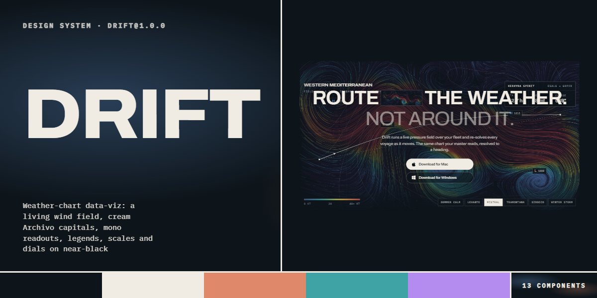

# Drift · design system

`drift@1.0.0` · 13 components · 104 tokens · dark

A scientific, data-heavy language for routing, weather, climate, geospatial and monitoring products: a near-black chart ground (#0D141A), giant cream Archivo capitals widened to 112% ("ROUTE THE WEATHER.") with the quieter half of each headline at 52% cream, Instrument Sans for copy and IBM Plex Mono for every label, axis tick, unit and readout at 11px uppercase. Behind the hero runs a living wind field: particles advected through the sum of six pressure vortices, trailing lines coloured by speed on an eight-bin ramp (--dr-wind-1 calm blue through teal and green to --dr-wind-8 gale red), with isobars every 4 hPa contoured from the same pressure, L and H chips that follow the systems, and a solved route bent against the wind beside the dashed great circle. The same field shrinks into a slot between the headline's words and into three dashboard plates, each with its own ground and way of drawing the wind (glacier stipple, aurora ribbons, moss barbs) under one instrument: a barograph, three ships with live speed, a re-solve countdown. Around it sit the reading aids a chart needs: a ramp legend over a kt scale with labelled bins, a longitude scale ruled by repeating gradients, instrument stats (growth bars, a 30-cell meter, a 0.25° heat grid, a solve clock), a bridge dial whose rings turn to each waypoint, and a live board where an agent types its log under sparkline rows. One cream pill and one keyed-frame button are the only drawn actions. Extracted from the Drift weather-routing page; the page's WebGL field is re-created in Canvas 2D from its own numbers and the scroll scene is left behind.

The full board, every component at once: [preview.jpg](preview.jpg)

**Explore it live:** [instalanding.ai/systems/drift](https://instalanding.ai/systems/drift) — every component rendered, a token playground and COPY FOR AGENT.

## Files

| File | What it is |
| --- | --- |
| [`specimen.html`](specimen.html) | Every component live in one file. Each is a `<section data-component>`; the markup inside `.sp-demo` is the component. Opens from disk. |
| [`tokens.css`](tokens.css) | The design tokens as CSS custom properties (`--dr-*`). |
| [`drift.css`](drift.css) | Tokens plus every component's CSS, scoped under `.dr` with `dr-` class names, so it can't restyle anything else on your page. |

## Use it

1. Load the fonts: `<link rel="stylesheet" href="https://fonts.googleapis.com/css2?family=Archivo:wdth,wght@62..125,300..800&family=IBM+Plex+Mono:wght@400;500&family=Instrument+Sans:wdth,wght@75..100,400..600&display=swap">`
2. Link `drift.css` and wrap the part of your page that uses the system in `
`.
3. Copy components from `specimen.html`. Interactive ones need the small script in its `<script id="dr-components-js">`.
4. Change the look by editing the tokens, not the components.

## Components

- Nav pill & menu
- Buttons, presets & status chips
- Type, labels & readouts
- Wind field hero
- Legends, scales & markers
- Instrument stats
- Field dashboards
- Advisory dial
- Live board
- API code plate
- Plans
- FAQ & sign-up
- Footer & longitude scale

## Conventions

**Typography**

- Archivo (--dr-font-display) sets every heading in capitals: weight 600, font-stretch --dr-stretch (112%), line-height .98, balanced. The hero statement is 620 at --dr-display with -.03em tracking; its second line (and the second half of .dr-display) drops to 400 in 52% cream. The wordmark is Archivo 800 at --dr-stretch-wide with .14em tracking.
- IBM Plex Mono (--dr-font-mono) is the instrument voice: every label, axis tick, unit, column head, status and log line is 11px (--dr-label), uppercase, tracked --dr-track-label, in --dr-muted. Never set a label smaller than --dr-label.
- Instrument Sans (--dr-font-body) carries copy at --dr-text (15px/1.6); ledes are --dr-lede in 76% cream, capped at 52ch. Figures are Archivo 500 with tabular numerals (stat numbers at --dr-figure, prices at --dr-price), with their unit beside them in mono at 13px muted.

**Colour**

- Night ground (--dr-bg, --dr-bg-2 for quiet bands) with cream ink (--dr-paper). Every hairline is a cream mix: --dr-rule (14%) between things, --dr-rule-strong (32%) round things you act on. Copy steps down in cream mixes (86%, 76%, 55%), never in greys.
- Meaning colours are fixed: --dr-low (rust) for lows, late deltas, holds and warnings; --dr-high (blue) for highs, early deltas, fetching and the solver's sweep; --dr-ok (green) for live dots, on-track and saved fuel; --dr-violet for solving; --dr-amber for pushing. They tint chips and marks, never large fills.
- The one paper-bright surface is the cream button or pill; there is one drawn primary per screen.

**Flow field & data-viz**

- The field is Canvas 2D, drawn by the component script into any .dr-map (hero: .dr-wind-canvas and .dr-chart-overlay), any [data-dr-field="slot"] (the headline slot) and any .dr-mini[data-dr-variant="systems|fleet|resolve"]. Wind is the sum of pressure vortices (x, y, spin, r, strength) plus a background drift; particles leave trails faded by a fill of the ground at --dr-field-fade, stroked at --dr-field-alpha. It runs at most 30 fps at DPR 1 (1.5 on dashboards), pauses off screen and in hidden tabs, and is set up again for markup added later.
- Speed is always the eight-bin wind ramp (--dr-wind-1 to --dr-wind-8, 0 to 42 kt), used the same way everywhere: field lines, the legend bar, the heat grid, sparklines, the dial's track bars. Show the ramp with its kt scale or labelled bins (.dr-legend-key) wherever colour carries speed, and put the figure in text beside every coloured mark (a sparkline's kt, a bar's waypoint number).
- Chart furniture is mono and hairline: captions (.dr-caption), L/H chips (.dr-iso-marker, letter in --dr-low or --dr-high beside the pressure), route keys (.dr-route-card-foot: solid for the solved track, dashed for the great circle), scales (.dr-legend-scale, .dr-viz-scale, .dr-footer-scale with its ticks every 1/30 and 1/6). Status chips (.dr-status) always carry their word, not just a dot.
- Dashboards keep their own ground and ramp (--dr-glacier-*, --dr-aurora-*, --dr-moss-*: low, mid and high stops) and accent (--dr-acc), with readouts on glass widgets (.dr-w, --dr-radius-widget, --dr-glass-widget) pinned to a corner.

**Buttons & forms**

- The primary is cream: .dr-pill-cta (a 2.75rem pill with an arrow that nudges 3px) in the nav, .dr-dl.dr-dl--mac for app downloads, or .dr-btn.dr-btn--solid, the keyed frame after the Uiverse button the page credits: a 2px cream frame with three gaps painted in --dr-key-bg and a dash before the label, emptying to an outline on hover. Set --dr-key-bg to the background the button sits on, or the gaps show as blocks.
- Secondary actions are hairlines: .dr-btn (square, --dr-rule-strong, a mono label), .dr-dl--win. Presets (.dr-mode-panel button) are square mono toggles that fill cream when on, with aria-pressed.
- Fields are a hairline box in --dr-rule-strong with the body face (.dr-signup input); status goes into .dr-form-status (role="status"). The demo form validates natively and sends nothing.

**Motion**

- Settle, don't bounce: entrances rise .6rem and fade over --dr-dur-settle on --dr-ease-out (the hero's furniture lands 1.1-1.2s after load); hovers take --dr-dur-hover; panels lift 3px.
- The menu wipes down on --dr-ease-wipe over --dr-dur-menu and its rows rise in 50ms apart; dial rings and hands turn on --dr-ease-dial over --dr-dur-dial; the stats hairline draws over --dr-dur-draw; live dots pulse on --dr-dur-pulse; the solve clock sweeps over --dr-dur-sweep.
- Data moves on its own cadence only while on screen: the field, the heat grid (every 0.9s), the dial (every 3.4s, paused 15s after a pick) and the board's agent. Under prefers-reduced-motion the fields build their trails once and hold, the stats appear filled, the dial shows its first waypoint and the board stays still.

**Accessibility**

- Canvases, the heat grid, dials and sparklines are aria-hidden; what they show is in text nearby (the route card's ETA, fuel and course; the dial's aria-live readout; each row's kt figure and status word). The hero h1 carries its full sentence in aria-label because its words are split around the slot.
- Presets and waypoint buttons use aria-pressed; the menu toggle has aria-expanded and a label that flips between Open and Close menu, and Escape closes the menu and returns focus to it.
- Focus is a 1px cream outline offset 3px. Cream on the night ground passes for all copy; keep the ramp, rust and blue for marks and short labels, never for paragraphs.

## Extracted from

- [Wind Field Routing Page](../../pages/wind-field-routing-page) · [live](https://instalanding.ai/demos/drift-wind-routing.html)

Every system is extracted from a real, working page: the components are its markup, not a redraw.

MIT.
