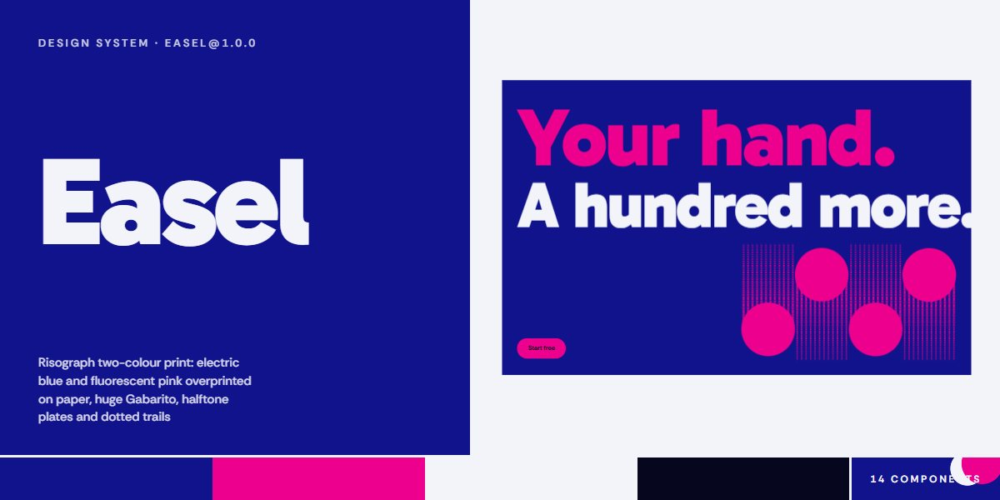

# Easel · design system

`easel@1.0.0` · 14 components · 45 tokens · dark

A two-ink print language for creative tools, studios, publishers and any product that wants to feel made by hand: an electric blue and a fluorescent pink overprinted on paper with multiply, Gabarito set huge and tight, and headings printed with a pink copy slightly out of register. Pink pills swell a circle of the opposite ink on hover, text links sit on a dotted underline whose dots swell into a solid bar, ring buttons drop their dot, and fields are square with a 2px line. Pictures are greyscale SVG turned duotone by two blend modes (black prints blue, white prints pink); halftone plates are radial-gradient dot screens in register; ink drums print dotted trails that thin as they run out; a paper ticket has a scalloped edge and prices a plan live. Extracted from the Easel AI Artist Assistant page.

The full board, every component at once: [preview.jpg](preview.jpg)

**Explore it live:** [instalanding.ai/systems/easel](https://instalanding.ai/systems/easel) — every component rendered, a token playground and COPY FOR AGENT.

## Files

| File | What it is |
| --- | --- |
| [`specimen.html`](specimen.html) | Every component live in one file. Each is a `<section data-component>`; the markup inside `.sp-demo` is the component. Opens from disk. |
| [`tokens.css`](tokens.css) | The design tokens as CSS custom properties (`--ea-*`). |
| [`easel.css`](easel.css) | Tokens plus every component's CSS, scoped under `.ea` with `ea-` class names, so it can't restyle anything else on your page. |

## Use it

1. Load the fonts: `<link rel="stylesheet" href="https://fonts.googleapis.com/css2?family=Gabarito:wght@700..900&family=Rethink+Sans:wght@400..700&display=swap">`
2. Link `easel.css` and wrap the part of your page that uses the system in `
`.
3. Copy components from `specimen.html`. Interactive ones need the small script in its `<script id="ea-components-js">`, and any that draw SVG art need its `<svg id="ea-defs">`.
4. Change the look by editing the tokens, not the components.

## Components

- Header
- Buttons, links & fields
- Type scale
- Press hero
- Printed panel & duotone photo
- Two-plate chart
- Five-step run
- Features & duotone photos
- Study rack
- Plan builder & ticket
- Use-case log
- FAQ
- Contact & drums
- Wordmark footer

## Conventions

**Typography**

- Two families. Gabarito for display: .ea-poster at 900 (line-height .86, -.035em), .ea-display at 800 (--ea-display, line-height .95, -.025em), .ea-title at 700. Rethink Sans for text: the root sets --ea-text at 400 with line-height 1.55, .ea-lead at 500, .ea-label at 600 in .06em capitals. Never set display type in Rethink Sans or below 700.
- Poster lines (.ea-press__line) fill their column: font-size min(210px, min(100cqi - 2 * --ea-gut, --ea-maxw) / (--ea-len * .45)) with --ea-len set to the letter count inline, inside a container-type: inline-size section. The footer wordmark does the same at .52.
- Any heading can carry data-ea-motion="register": a text-shadow copy in pink (or --ea-register-ink) offset by --ea-register-x / -y at opacity --ea-register-a. Hold it at --ea-misregister for the printed look, or animate it to 0 as the heading settles.

**Color & print**

- Two inks and a paper: --ea-blue is the page (the root's background), --ea-pink the accent ink, --ea-paper the stock, --ea-ink the near-black for text on pink and on paper notes. Sections alternate blue, paper and pink panels; there are no other colours and no greys.
- Overprint with mix-blend-mode: multiply (two plates, the process sheet) so blue over pink darkens like real ink. Halftones are radial-gradient dot screens (circle closest-side, currentColor 62% / 88%) tiled at --ea-dot, the pink plate at --ea-dot-pink and offset, so the screens never align.
- Rules are colour-mixed from the panel's own ink: --ea-rule-on-blue, --ea-rule-on-paper, --ea-rule-on-pink at --ea-hair; section-heading rules are 2px (--ea-rule) solid or dotted in full ink.

**Pictures & shapes**

- Pictures are greyscale inline SVG inside .ea-photo: the SVG is lightened over a blue background and a pink ::after darkens over it, so black prints blue and white prints pink. Fill shapes from the shared #ea-defs patterns (ea-p-dot, ea-p-wood, ea-g-light ...); include that <svg> once per page. Never use image files.
- Studies (svg[data-ea-art="<seed>"]) are drawn by the component script from a seed: a two-stop sky, a hill, a halftone hill, an arc and two to four discs.
- Corners are square except pills (--ea-pill) and discs (.ea-disc). The ticket (.ea-surface) has a scalloped top edge cut by a repeating radial mask of --ea-scallop. Ink drums (.ea-lane with .ea-drum and .ea-trail) print a trail of 80 shrinking dots up (.ea-lane--up) or down a lane.
- Buttons: .ea-btn (pink, ink label) on blue, .ea-btn-2 (blue) on paper, each with a __label span; .ea-link for dotted text links; .ea-icon-btn for ring buttons with an __dot and a visually hidden __name; .ea-field for square inputs. Layout uses .ea-wrap (the --ea-maxw column) and .ea-grid (12 columns, 4 under 900px).

**Motion**

- Everything eases on --ea-ease (cubic-bezier(.3,.7,.2,1)). Pill hovers swell a circle of the opposite ink over --ea-dur-fill; link dots swell solid over --ea-dur-dot (an animated @property); ring dots drop over --ea-dur-icon.
- The hero prints itself once: the poster lines rise from a clip over --ea-dur-rise, the drums drop in on --ea-ease-drop with a small overshoot and stagger, their trails print down or up over --ea-dur-print, then the drums bob on --ea-bob, paused while the hero is off screen.
- All of it runs only under prefers-reduced-motion: no-preference; without it every component is complete and still.

**Accessibility**

- Drums, plates, trails and the process sheet are aria-hidden; duotone pictures and studies carry role="img" and an aria-label. The FAQ uses native details and summary; plan choices are real radio inputs inside labelled fieldsets.
- The header has a skip link, a ring toggle with aria-controls and aria-expanded that opens a full-screen pink sheet, and Escape or a link closes it. The signup reports through a role=status line; the ticket total is aria-live.
- Focus rings are --ea-focus solid pink, ink on pink panels. Text stays paper on blue, blue on paper and ink on pink.

## Extracted from

- [Easel AI Artist Assistant Page](../../pages/easel-ai-artist-assistant-page) · [live](https://instalanding.ai/demos/easel-artist-assistant.html)

Every system is extracted from a real, working page: the components are its markup, not a redraw.

MIT.
