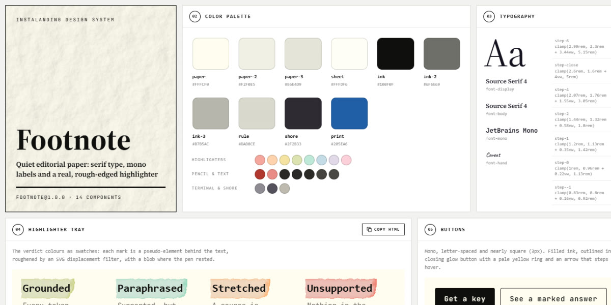

# Footnote · design system

`footnote@1.0.0` · 14 components · 65 tokens · light

Warm Flexoki paper and ink, Source Serif set calm and large, JetBrains Mono labels, sheets and taped cards with creased paper texture, pencil notes in the margin, and a real highlighter whose colour is the meaning: rough-edged marks drawn behind the text by an SVG displacement filter. Extracted from the Highlighter Markup landing page.

**Explore it live:** [instalanding.ai/systems/footnote](https://instalanding.ai/systems/footnote) — every component rendered, a token playground and COPY FOR AGENT.

## Files

| File | What it is |
| --- | --- |
| [`specimen.html`](specimen.html) | Every component live in one file. Each is a `<section data-component>`; the markup inside `.sp-demo` is the component. Opens from disk. |
| [`tokens.css`](tokens.css) | The design tokens as CSS custom properties (`--fn-*`). |
| [`footnote.css`](footnote.css) | Tokens plus every component's CSS, scoped under `.fn` with `fn-` class names, so it can't restyle anything else on your page. |

## Use it

1. Load the fonts: `<link rel="stylesheet" href="https://fonts.googleapis.com/css2?family=Source+Serif+4:ital,opsz,wght@0,8..60,400;0,8..60,600;0,8..60,700;1,8..60,400&family=JetBrains+Mono:wght@400;500;700&family=Caveat:wght@400..700&display=swap">`
2. Link `footnote.css` and wrap the part of your page that uses the system in `
`.
3. Copy components from `specimen.html`. Interactive ones need the small script in its `<script id="fn-components-js">`, and any that draw SVG art need its `<svg id="fn-defs">`.
4. Change the look by editing the tokens, not the components.

## Components

- Navigation
- Buttons
- Highlighted headline
- Highlighter tray
- Section head
- Marked answer
- Figures
- Numbered steps
- Annotated listing
- Taped cards
- Margin notes
- Run log
- Closing call
- Footer

## Conventions

**Typography**

- Display and body are Source Serif 4 (--fn-font-display / --fn-font-body): headings weight 600, letter-spacing -0.02em to -0.025em, text-wrap: balance, on the fluid --fn-step-* scale (--fn-step-6 for the hero, --fn-step-4 for section heads).
- Labels, buttons, nav and captions are JetBrains Mono (--fn-font-mono) at --fn-step--1; labels are uppercase with --fn-tracking-label (.14em) in --fn-ink-2 (.fn-label).
- Handwriting is Caveat (--fn-font-hand) in --fn-pencil through the #fn-crayon filter (.fn-scrawl), used only for margin notes, never for content.

**Layout**

- Text holds a reading measure (.fn-wrap: min(74ch, 100% - 3rem)); wider pieces use .fn-wide (max 1100px). Sections are separated by 1px --fn-rule lines with --fn-section-y padding.
- Content sits on sheets and cards (.fn-paper) that carry creased-paper texture via #fn-paper, soft drop shadows (--fn-shadow-sheet / --fn-shadow-card) and a slight tilt (--r, --fn-tilt-*). Never a hard border box.
- Grids go 4 → 2 → 1 columns at 900px and 520px; the payload and steps stack under 900px.

**Marks**

- A highlight is <mark> with a verdict class: .fn-hl-green grounded, .fn-hl-cyan paraphrased, .fn-hl-orange stretched, .fn-hl-red unsupported (yellow is the default). The colour is the meaning; don't use marks decoratively.
- The colour, grain and rough edge live on mark::before (through --color), never on the glyphs; the filter #fn-rough needs the shared <svg id="fn-defs">.
- A mark is inline-block so it cannot wrap: give multi-word marks data-fn-split and include the component script, which splits them into one mark per word (only the last keeps the pen blob).

**Motion**

- Quiet by design: buttons ease background in --fn-dur-press, the glow button's arrow steps 4px on hover, the FAQ + rotates 45deg when open.
- Marks can draw on with a left-to-right clip (--fn-ease-pen over --fn-dur-pen) and the pen blob pops in on --fn-ease-blob, under an .fn-hl-anim class on an ancestor; without it the marks are simply there.
- The run log cursor blinks on --fn-dur-blink.

**Accessibility**

- Claims are real buttons with aria-expanded; their source note opens beneath the sheet. FAQ uses native details/summary.
- Focus is a 2px ink outline offset 3px on buttons, claims and summaries.
- Marks carry meaning by colour and by word (Grounded, Stretched…): keep a text label beside any colour-only verdict. prefers-reduced-motion drops all animation and transitions to near zero.

## Extracted from

- [Highlighter Markup Page](../../pages/highlighter-markup-page) · [live](https://instalanding.ai/demos/footnote-grounding.html)

Every system is extracted from a real, working page: the components are its markup, not a redraw.

MIT.
