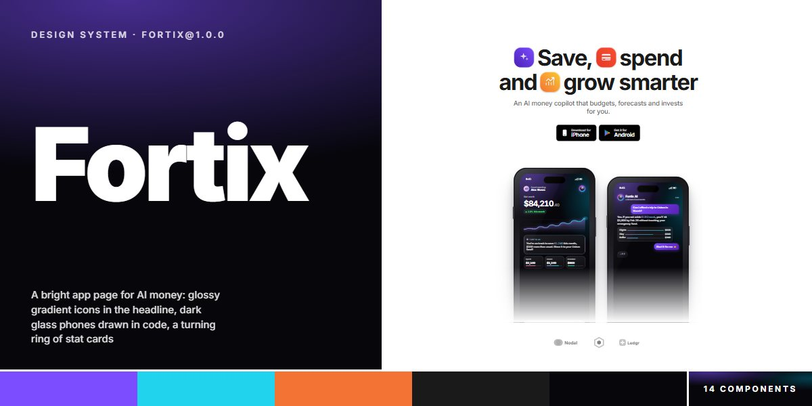

# Fortix · design system

`fortix@1.0.0` · 14 components · 97 tokens · light

A bright, airy app-page language for AI consumer products, fintech copilots and mobile apps: white ground, one ink colour at 65/50/10/5% tints, Inter 700 set tight at -.04em, and seven 225deg gradients spent on glossy squircle app icons that sit inside the headline, stat cards, badges and coins. The product shows on dark glass phones drawn entirely in HTML, CSS and SVG and sized by width alone (container queries): violet and cyan light pooling on near-black, glass cards with gradient hairlines, glowing smooth charts, a forecast with a confidence band, progress rings, autopilot toggles and a blocked-fraud alert. Motion is 3D and calm: five stat cards turn on a ring, a landscape dashboard tips up into view, and feature cards come round on a tap-through carousel. Extracted from the Fortix AI Money Copilot app page.

The full board, every component at once: [preview.jpg](preview.jpg)

**Explore it live:** [instalanding.ai/systems/fortix](https://instalanding.ai/systems/fortix) — every component rendered, a token playground and COPY FOR AGENT.

## Files

| File | What it is |
| --- | --- |
| [`specimen.html`](specimen.html) | Every component live in one file. Each is a `<section data-component>`; the markup inside `.sp-demo` is the component. Opens from disk. |
| [`tokens.css`](tokens.css) | The design tokens as CSS custom properties (`--fx-*`). |
| [`fortix.css`](fortix.css) | Tokens plus every component's CSS, scoped under `.fx` with `fx-` class names, so it can't restyle anything else on your page. |

## Use it

1. Load the fonts: `<link rel="stylesheet" href="https://fonts.googleapis.com/css2?family=Inter:wght@400;500;600;700;800;900&display=swap">`
2. Link `fortix.css` and wrap the part of your page that uses the system in `
`.
3. Copy components from `specimen.html`. Interactive ones need the small script in its `<script id="fx-components-js">`, and any that draw SVG art need its `<svg id="fx-defs">`.
4. Change the look by editing the tokens, not the components.

## Components

- Navigation
- Store buttons, icons & chips
- Proof lines & headings
- Hero with phones
- Phone & net-worth screen
- AI chat screen
- Stat ring
- Feature split blocks
- Forecast & fraud alert
- Floating badges & bubbles
- Landscape dashboard
- 3D feature carousel
- Download CTA
- Footer

## Conventions

**Typography**

- Inter is the only face (400-900) with tabular figures on (font-feature-settings "cv03", "cv04", "cv09", "cv11", "tnum" on .fx). Headings are 700 at -.04em: h1 --fx-h1 (line-height .96), h2 --fx-h2, h3 and .fx-h3 --fx-h3 (1.04); the page steps them down at 1159px and 767px.
- Leads (.fx-lead) are --fx-lead 500 at -.02em in --fx-ink65; labels (.fx-label) are --fx-label 500 in --fx-ink50 and sit above an h2 inside .fx-hd. Proof paragraphs (.fx-about .fx-big) run at --fx-h2 in --fx-ink50 with the key phrase in a <b> at full ink.
- Inside the phones everything is in em off the screen's 3.85cqw: balances 2.9em 700 at -.05em, kickers in .fx-mu (55% white), AI figures in .fx-gt (the --fx-text-gradient clipped to text).

**Color & composition**

- The page is white (--fx-bg) and ink (--fx-ink with --fx-ink65/50/10/05). Colour only arrives as the 225deg gradients (--fx-g-purple, -red, -orange, -pink, -green, -blue, -cyan), built from the --fx-* stops so recolouring a stop recolours its gradient.
- Gradients fill things, never text on white: app icons (.fx-ic with .fx-p / .fx-r / .fx-o), stat cards, badge pills, coins, the security chip and feature cards. Keep one gradient per object.
- The product lives on dark screens (--fx-screen: violet, cyan and pink light pooling on --fx-night) with their own palette: --fx-lilac and --fx-cyan for charts and rings, --fx-up for gains, --fx-alert for the fraud card. Never put the dark palette on the white page outside a device.
- Content sits in one --fx-wrap (800px) column with --fx-gut sides; sections stack --fx-sec apart (the host applies it: components carry no outer margin).

**Devices & glass**

- A phone is 

…

: aspect-ratio .462 and container-type: inline-size, so size it by width only and never resize what is inside. The frame is --fx-frame with --fx-shadow-device; the island and glare are the screen's ::before/::after.
- Inside a screen: .fx-sb status bar, .fx-sc content, .fx-hdr header row, .fx-g glass cards (--fx-glass, a 10% white hairline, --fx-blur), .fx-ai adds the gradient hairline, .fx-chart is a smooth SVG line with a vector-effect stroke, .fx-ring a progress ring, .fx-tg toggles (.fx-off), .fx-tabbar / .fx-inputbar pin to the foot.
- The landscape dashboard (.fx-wide > .fx-ws) is the same device at aspect-ratio 2.16 with type in 1.85cqw and a three-column grid.
- App icons (.fx-ic) are gradient squircles with a --fx-gloss highlight and a glyph from #fx-defs (<svg viewBox="0 0 40 40"><use href="#fx-i-spark"/></svg>, also fx-i-card and fx-i-grow); include the defs once per page.

**Motion**

- Settles ease on --fx-ease (cubic-bezier(.2,.8,.2,1)); the ring and the carousel turn on --fx-ease-turn over --fx-dur-ring and --fx-dur-turn. Hovers take --fx-dur-hover: links tint 5%, store buttons lift 2px, chevrons slide 4px, the mark inverts.
- The stat ring turns one place every --fx-ring-step and the carousel every --fx-carousel-step (the script reads both tokens at load; it pauses on hover or focus). Orbs spin on --fx-spin, coins float on --fx-float out of step, typing dots blink on --fx-blink.
- .fx-wide and .fx-carousel start tipped back and scaled down; add .fx-in to settle them (an IntersectionObserver is the usual trigger). Under prefers-reduced-motion everything shows settled and nothing loops.

**Accessibility**

- Phones, the dashboard and the stat ring are pictures: keep aria-hidden on them and say what matters in the copy beside them.
- The carousel is role="button" with tabindex 0 and an aria-label; a click, Enter or Space brings the next card round. The burger has aria-expanded and aria-controls, the closed menu is visibility: hidden (out of the tab order) and Escape closes it.
- Focus shows a 2px --fx-violet outline offset 3px. Body copy stays at --fx-ink65 or darker on white; --fx-ink50 is for labels and the de-emphasised half of proof lines only.

## Extracted from

- [Fortix AI Money Copilot App Page](../../pages/fortix-ai-money-copilot-app-page) · [live](https://instalanding.ai/demos/fortix-ai-money-copilot.html)

Every system is extracted from a real, working page: the components are its markup, not a redraw.

MIT.
